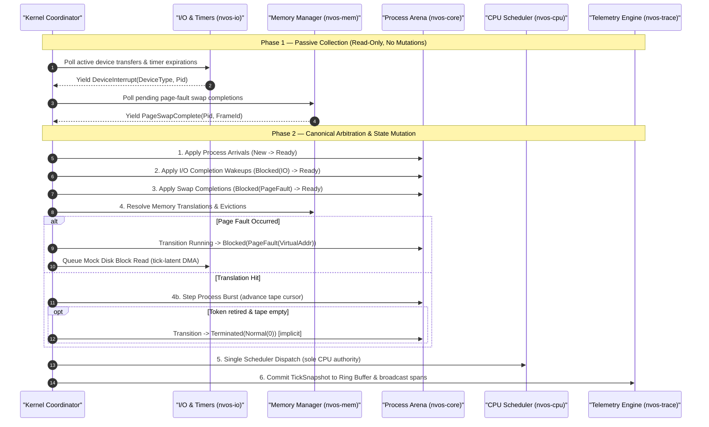
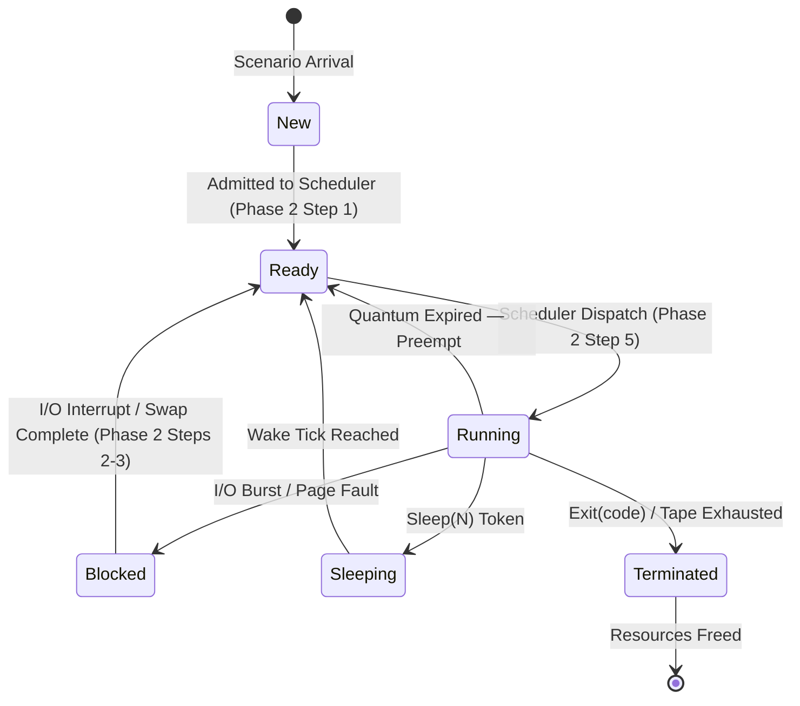
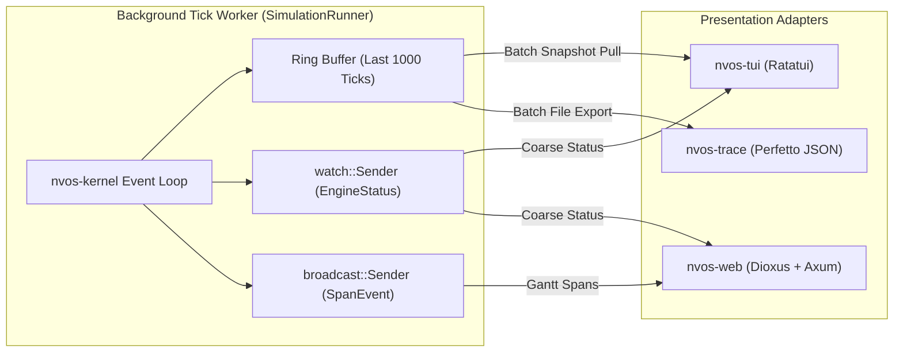

# Technical Design Document: nvos (Deterministic Discrete-Event OS Simulator)

* **Author:** cristiano-s-r-filho
* **Date:** 2026-11-18
* **Status:** Revised — All multi-lens review findings applied (Stages 5–9)

> [!NOTE]
> This document is the canonical design reference. Detailed per-subsystem
> specifications live under [`docs/designs/subsystems/`](./SITEMAP.md).
> Every section cross-links to the relevant subsystem spec.

---

## 1. The Problem

Operating systems education and algorithmic research require inspecting complex
interactions between CPU scheduling, memory hierarchy management, filesystem
operations, and asynchronous I/O devices. Existing approaches present major
pedagogical and engineering pain points:

1. **Non-Determinism in Real Concurrency:** Simulating OS primitives using
   host OS threads, asynchronous timers, or wall-clock intervals introduces
   race conditions, thread-scheduling jitter, and reproducibility failures.
   Reproducing an edge case — such as a priority inversion or a race between
   an I/O completion interrupt and a page fault — across runs becomes
   virtually impossible.

2. **Subsystem Entanglement in Monoliths:** Traditional educational operating
   systems (xv6, Pintos) couple process management, page tables, disk drivers,
   and schedulers tightly into a monolithic kernel. Evaluating an isolated
   component (e.g., comparing Multi-Level Feedback Queue against Round Robin,
   or measuring Buddy Allocator fragmentation) requires running the entire
   kernel, making isolated benchmarking and unit testing cumbersome.

3. **Observability and Telemetry Gap:** Most educational simulators output
   unstructured stdout logs. When tracing multiple processes interleaving
   across CPU bursts, disk seeks, and page replacement cycles, text logs fail
   to convey temporal relationships. Visual timeline alignment (Gantt charts)
   and step-by-step inspection are absent from standard CLI tools.

4. **Toolchain Fragmentation:** Existing simulators with graphical
   visualization often split the implementation across different languages
   (a C kernel with a Python/Tkinter or JavaScript/React frontend),
   introducing FFI (Foreign Function Interface) bridges, npm dependencies,
   and cross-compilation friction.

---

## 2. Overview

`nvos` is a modular, pure-Rust discrete-event operating system simulator
engineered to solve these challenges. Processes — modeled after Andrew S.
Tanenbaum's classic Process Control Block (PCB) specification in *Modern
Operating Systems* — execute abstract instruction bursts against simulated
hardware subsystems:

* **Discrete-Event Kernel (`nvos-kernel`):** A deterministic event-driven core
  driven by a virtual clock (`Tick(u64)`). Eliminates wall-clock time and
  non-deterministic hashing, ensuring 100% reproducible execution traces for
  any given seed and scenario.

* **Error Hierarchy (`nvos-core::error` + `nvos-kernel::panic_boundary`):**
  A two-tier error model separates *guest-side traps* (`GuestTrap`) from
  *engine-side failures* (`KernelEngineError`). Pluggable policies (schedulers,
  allocators) execute inside a `catch_unwind` boundary in
  `panic_boundary::safe_subsystem_dispatch()`, preventing student-code bugs
  from crashing the host process.

* **Decoupled Architecture:** Subsystems (CPU scheduling, dual-layer memory
  management, mock inode filesystem, I/O devices) are independent crates in
  a Cargo workspace. Each subsystem implements clean trait contracts that
  return `Result<T, E>` — enabling isolated unit testing without instantiating
  the kernel.

* **Two-Phase Commit Tick Loop (synchronous gather-and-arbitrate cycle,
  distinct from distributed 2PC consensus protocols):** Phase 1 is strictly
  passive — it collects hardware completions and wakeup events only. Phase 2
  arbitrates and applies all state mutations in canonical priority order,
  with the scheduler as the single authority for CPU dispatch.

* **Tiered Telemetry & Sliding Window:** A configurable in-memory ring buffer
  (`N = 1000` ticks) stores full `TickSnapshot` structs (~20 KB each, ~20 MB
  total — negligible for educational workloads) for time-travel stepping.
  Coarse engine status (Play/Pause, current tick) flows through a
  `tokio::sync::watch` channel. Per-process state-transition spans for the
  Gantt chart flow through a `tokio::sync::broadcast` channel or ring-buffer
  batch pull to avoid intermediate-tick loss from `watch`'s lossy semantics.

* **Dual Pure-Rust Interfaces:**
  * **Interactive TUI (`nvos-tui`):** High-density terminal dashboard built
    with `ratatui` for local stepping and inspection.
  * **Visual Web Dashboard (`nvos-web`):** Pure-Rust frontend built with
    **Dioxus**, offering live WebSocket telemetry, system controls, and an
    interactive **Gantt Chart** plotting process states against discrete tick
    timestamps. `nvos-web/Cargo.toml` uses `[target.'cfg(...)'.dependencies]`
    conditional blocks to separate `axum`/`tokio` (native) from `dioxus-web`
    (wasm32) in a single crate, avoiding dual-target compilation deadlock.

---

## 3. Goals

* **Strict Reproducibility:** All simulation runs produce identical state
  sequences and event logs for any given scenario seed and configuration.

* **Pedagogical Fidelity to Tanenbaum's Modern OS:** Model PCBs with realistic
  process table fields: Process ID (PID), Parent PID (PPID), registers, state
  transitions, CPU usage accounting, priority levels, memory limits, and open
  file descriptors.

* **Pluggable Subsystem Policies:** Enable users to implement and test
  alternative algorithms via standalone Rust traits without modifying kernel
  harness code:
  * *CPU Schedulers:* First-Come First-Served (FCFS), Round Robin (RR) with
    preemption, Shortest Job First / Shortest Remaining Time First (SJF/SRTF),
    and Multi-Level Feedback Queue (MLFQ).
  * *Memory Allocators:* Paging with page replacement (FIFO, LRU, Clock)
    alongside contiguous physical heap allocation (First-Fit, Best-Fit,
    Buddy Allocator).

* **Resilient Subsystem Trait Contracts:** All subsystem traits return
  `Result<T, E>` to allow safe integration with pluggable student algorithms.

* **Panic Isolation Boundary:** Pluggable policies execute inside
  `catch_unwind` preventing host-process crashes from student-code bugs.

* **Mock Inode Storage Engine:** In-memory Unix-style filesystem with
  superblocks, inode allocation bitmaps, direct and indirect block pointers,
  and file descriptor resolution. Disk data transfer is dispatched through
  `nvos-io` with tick-accurate Direct Memory Access (DMA) latency — the
  `FileSystem` trait resolves only block metadata synchronously.

* **Interrupt and DMA Simulation:** Timer interrupts, disk-controller DMA
  transfers, and peripheral I/O latencies modeled deterministically in ticks.

* **Zero-FFI, Pure-Rust Ecosystem:** Entire stack — kernel core to TUI and
  Dioxus Web UI — in 100% safe Rust.

* **Automated Scenarios and Testing:** Declarative TOML scenario files script
  process arrival, burst sequences, and memory footprints for reproducible
  benchmarking and automated grading.

* **Property & Mutation Testing:** Determinism invariants verified via
  `proptest` stochastic property tests; policy robustness verified via
  `cargo-mutants` mutation coverage.

---

## 4. Non-Goals

* **Hardware Architecture Emulation:** No binary execution of x86, ARM, or
  RISC-V machine instructions. Processes execute abstract synthetic burst
  tokens, not raw assembly.

* **Host OS Thread Mapping:** Simulated processes do not map to host OS
  threads (`std::thread`). Concurrency is strictly discrete and event-driven.

* **POSIX Compliance:** Syscalls, filesystem semantics, and error codes are
  simplified educational models, not a certified POSIX implementation.

* **Production Driver Integration:** No interaction with real physical hardware
  or host kernel async I/O subsystems (`io_uring`, `epoll`).

* **Multi-Node Distributed OS Simulation:** Single-node model only;
  distributed scheduling and network consensus are out of scope.

* **Inverse Mutation Delta Snapshots:** A log of reverse mutations was
  considered for time-travel and rejected (see Section 6.7). Full snapshots
  are used instead.

---

## 5. Technical Plan

> See also: [subsystems/](./SITEMAP.md) for detailed per-subsystem specs.

### 5.1. System Architecture & The Two-Phase Tick Cycle

The simulator is a deterministic discrete-event state machine coordinated by
`nvos-kernel`. Time progresses in discrete units: `Tick(u64)`.

The **Two-Phase Commit** (synchronous gather-and-arbitrate cycle, distinct from
distributed 2PC consensus protocols) eliminates intra-tick race conditions and
circular event cascades between subsystems:

* **Phase 1 — Passive Collection (read-only):** Hardware completions
  (I/O interrupts, swap readiness, timer expirations) are gathered. No
  scheduler is invoked here; no PCB state is mutated. This phase is strictly
  an observation pass.

* **Phase 2 — Canonical Arbitration & Mutation:** State mutations are applied
  in a fixed priority order. The CPU scheduler is the *sole* dispatch authority
  and runs exactly once — at Step 5, after all wakeups and arrivals are
  resolved. This eliminates the double-dispatch hazard present in earlier
  drafts.



> **See also:** [subsystems/01\_kernel\_and\_pcb.md](./subsystems/01_kernel_and_pcb.md)

---

### 5.2. Process Control Block (PCB) & State Machine

`nvos` structures process representation around the Tanenbaum PCB model.

> **See also:** [subsystems/01\_kernel\_and\_pcb.md](./subsystems/01_kernel_and_pcb.md)

#### 5.2.1. Process Control Block Layout (`nvos-core`)

Key changes from the initial draft:
- `pending_io: Option<PendingIoRequest>` **removed** — pending I/O state lives
  in `nvos-io`'s device manager, not the PCB. Cross-crate type leakage
  eliminated.
- `current_token_progress: u32` **added** — tracks partial execution of
  multi-tick `Cpu(N)` tokens across preemption boundaries. Without this field,
  a process preempted at tick 2 of a `Cpu(5)` token would lose 3 ticks of
  progress on reschedule.
- `page_table_root` and `allocated_heap_blocks` use **opaque primitive ID
  types** (`PageTableId(pub u32)`, `HeapBlockId(pub u32)`) defined in
  `nvos-core`. No types from `nvos-mem` or `nvos-io` appear in this struct.

```rust
/// Process ID. Unique per simulation run; never reused after Terminated.
#[derive(Debug, Clone, Copy, PartialEq, Eq, Hash, PartialOrd, Ord)]
pub struct Pid(pub u32);

/// Parent Process ID (PPID). None for init/root processes.
pub type PPid = Option<Pid>;

/// Opaque handle to this process's root page table (owned by nvos-mem).
#[derive(Debug, Clone, Copy, PartialEq, Eq)]
pub struct PageTableId(pub u32);

/// Opaque handle to a heap block (owned by nvos-mem heap allocator).
#[derive(Debug, Clone, Copy, PartialEq, Eq)]
pub struct HeapBlockId(pub u32);

#[derive(Debug, Clone, PartialEq, Eq)]
pub struct ProcessControlBlock {
    // --- Identification ---
    pub pid: Pid,
    pub ppid: PPid,
    pub name: String,

    // --- Process State & Scheduling ---
    pub state: ProcessState,
    pub priority: PriorityLevel,
    pub base_priority: PriorityLevel,
    pub quantum_remaining: u32,

    // --- Instruction Tape Cursor ---
    /// Index of the currently executing token in `execution_tape`.
    pub program_counter: usize,
    /// Ticks consumed on the *current* token (for multi-tick Cpu(N) tokens).
    /// Resets to 0 when a token is retired.
    pub current_token_progress: u32,

    // --- CPU Accounting (Tanenbaum model) ---
    pub cpu_time_consumed: u64,
    pub arrival_tick: Tick,
    pub completion_tick: Option<Tick>,

    // --- Memory Space (Dual-Layer, opaque IDs only) ---
    pub memory_limits: MemoryLimits,
    pub page_table_root: Option<PageTableId>,
    pub allocated_heap_blocks: Vec<HeapBlockId>,

    // --- Filesystem ---
    pub file_descriptors: BTreeMap<FileDescriptor, InodeId>,

    // --- Instruction Tape ---
    pub execution_tape: Vec<InstructionToken>,
}
```

#### 5.2.2. Process State Machine & Transitions

The canonical process state enum is defined in `nvos-core::process`. All
subsystem specs and kernel code use these exact variant names — no other
naming set is valid.

**7 canonical lifecycle states:**

| State | Description |
|---|---|
| `New` | Arrived from scenario; not yet admitted to scheduler |
| `Ready` | In scheduler queue; waiting for CPU dispatch |
| `Running` | Actively executing on the simulated CPU core |
| `Blocked(BlockReason)` | Suspended waiting for a resource or event |
| `Sleeping(Tick)` | Voluntarily delayed until `Tick` via `Sleep(N)` token |
| `Terminated(ExitReason)` | Execution complete; pending resource reap |
| *(reaped)* | PCB slot freed from arena; no state entry |

```rust
#[derive(Debug, Clone, PartialEq, Eq)]
pub enum ProcessState {
    New,
    Ready,
    Running,
    Blocked(BlockReason),
    Sleeping(Tick),
    Terminated(ExitReason),
}

#[derive(Debug, Clone, PartialEq, Eq)]
pub enum BlockReason {
    Io { device_id: u32 },
    PageFault { virtual_addr: u32 },
}

#[derive(Debug, Clone, PartialEq, Eq)]
pub enum ExitReason {
    Normal(i32),
    SegmentationFault,
    IllegalInstruction,
    Killed,
}
```



#### 5.2.3. Synthetic Instruction Tape

Each process carries a `Vec<InstructionToken>` parsed from scenario TOML files.
The kernel advances `program_counter` and `current_token_progress` atomically
during Phase 2 Step 4b.

**Tape exhaustion rule:** If the tape is exhausted (all tokens consumed) with
no explicit `Exit` token, the kernel implicitly applies
`Terminated(ExitReason::Normal(0))`. The tape cursor never panics on an empty
slice — this is enforced at the engine level.

```rust
#[derive(Debug, Clone, PartialEq, Eq)]
pub enum InstructionToken {
    /// Consumes N CPU ticks without blocking.
    /// `current_token_progress` tracks partial execution across preemptions.
    Cpu(u32),
    /// Allocates `bytes` on the simulated heap.
    Alloc { bytes: usize },
    /// Frees a heap block by opaque ID.
    Free { block_id: usize },
    /// Memory read at virtual address — triggers Translation Lookaside Buffer
    /// (TLB) lookup and may cause a PageFault.
    MemoryRead { virtual_addr: u32 },
    /// Memory write at virtual address.
    MemoryWrite { virtual_addr: u32 },
    /// Triggers file read: `nvos-fs` resolves block IDs (zero ticks),
    /// then `nvos-io` disk controller performs DMA transfer (tick-latent).
    FileRead { fd: FileDescriptor, bytes: usize },
    /// Triggers file write: block allocation via `nvos-fs`, then DMA write.
    FileWrite { fd: FileDescriptor, bytes: usize },
    /// Voluntarily suspends process for N ticks (Sleeping state).
    Sleep(u32),
    /// Explicit process exit with status code.
    Exit(i32),
    /// Chaos/fault injection for integration testing.
    FaultInject { target: FaultTarget, error_code: u32 },
}

#[derive(Debug, Clone, PartialEq, Eq)]
pub enum FaultTarget {
    /// Force a simulated segmentation fault on the running process.
    SegFault,
    /// Force a disk controller error on the next I/O request.
    DiskError,
    /// Trigger an out-of-memory condition in the frame allocator.
    MemoryPressure,
}
```

> **See also:** [subsystems/01\_kernel\_and\_pcb.md](./subsystems/01_kernel_and_pcb.md)

---

### 5.3. Workspace Decomposition & Crate Boundaries

```text
nvos/
├── Cargo.toml                        # Virtual workspace root
├── mutants.toml                      # cargo-mutants configuration
├── crates/
│   ├── nvos-core/                    # Tick, Pid, ProcessState, PCB, InstructionToken, error types
│   ├── nvos-cpu/                     # Scheduler trait + FCFS, RR, MLFQ, SJF implementations
│   ├── nvos-mem/                     # FrameAllocator, PageTable, TLB, replacement/heap policies
│   ├── nvos-fs/                      # Inode filesystem: Superblock, InodeTable, MockBlockDevice
│   ├── nvos-io/                      # Virtual devices: Timer, DiskController, InterruptBus
│   ├── nvos-kernel/                  # Discrete-event engine, Two-Phase Tick Orchestrator
│   ├── nvos-trace/                   # Ring-buffer telemetry, Chrome Tracing/Perfetto exporters
│   ├── nvos-scenario/                # Declarative TOML scenario parser & workload generator
│   ├── nvos-tui/                     # Ratatui terminal dashboard & interactive controller
│   ├── nvos-web/                     # Dioxus pure-Rust web app + Axum server + Gantt chart
│   └── nvos-cli/                     # Unified CLI binary (headless, TUI, web runner)
└── data/
    └── scenarios/                    # Bundled TOML scenario files
```

#### Crate Dependency Graph

> **Note on `nvos-web`:** Axum and Tokio are native-only targets. Dioxus-web
> compiles to wasm32. These are separated using `[target.'cfg(...)'.dependencies]`
> in `nvos-web/Cargo.toml` — they are **never both present** at link time.

```mermaid
graph TD
    "nvos-core" --> "nvos-cpu"
    "nvos-core" --> "nvos-mem"
    "nvos-core" --> "nvos-fs"
    "nvos-core" --> "nvos-io"
    "nvos-core" --> "nvos-trace"

    "nvos-cpu" --> "nvos-kernel"
    "nvos-mem" --> "nvos-kernel"
    "nvos-fs" --> "nvos-kernel"
    "nvos-io" --> "nvos-kernel"
    "nvos-trace" --> "nvos-kernel"

    "nvos-scenario" --> "nvos-kernel"

    "nvos-kernel" --> "nvos-tui"
    "nvos-kernel" --> "nvos-web"
    "nvos-kernel" --> "nvos-cli"
    "nvos-tui" --> "nvos-cli"
    "nvos-web" --> "nvos-cli"
```

---

### 5.4. Core Trait Contracts & Interfaces

All subsystem traits return `Result<T, E>`. This applies without exception —
schedulers, allocators, and the kernel integration trait alike. The rationale:
pluggable student implementations may contain bugs; a `Result` return forces
the kernel to handle errors explicitly rather than silently receiving `()` and
proceeding with corrupt state.

> **See also:**
> [subsystems/02\_cpu\_and\_scheduling.md](./subsystems/02_cpu_and_scheduling.md),
> [subsystems/03\_memory\_management.md](./subsystems/03_memory_management.md),
> [subsystems/04\_filesystem\_and\_io.md](./subsystems/04_filesystem_and_io.md)

#### 5.4.1. CPU Scheduler Trait (`nvos-cpu`)

Changes from the initial draft:
- `tick()` now returns `Result<SchedulingAction, SchedulerError>`.
- `add_process()` now returns `Result<(), SchedulerError>`.
- `SchedulingAction::Preempt` **no longer carries `next_pid`**. The scheduler
  signals *intent* (preempt the current process); the kernel independently
  calls `schedule_next()` in Phase 2 Step 5. Carrying `next_pid` inside the
  action made the scheduler a co-dispatch authority — a dual-authority hazard.

```rust
pub trait Scheduler: Send + Sync {
    /// Register a newly arrived or awakened process.
    fn add_process(&mut self, pid: Pid, priority: PriorityLevel)
        -> Result<(), SchedulerError>;

    /// Select the next process to run. Called once per tick in Phase 2 Step 5.
    fn schedule_next(&mut self, current_tick: Tick) -> Option<Pid>;

    /// Advance quantum tracking for the active process.
    /// Returns the scheduling action for the current tick.
    fn tick(&mut self, running_pid: Option<Pid>) -> Result<SchedulingAction, SchedulerError>;

    /// Notify that a process blocked on I/O or a page fault.
    fn on_process_blocked(&mut self, pid: Pid, reason: BlockReason);

    /// Notify that a process terminated.
    fn on_process_terminated(&mut self, pid: Pid);
}

/// Scheduling decision for the current tick.
/// Does NOT carry next_pid — the kernel calls schedule_next() independently.
#[derive(Debug, Clone, PartialEq, Eq)]
pub enum SchedulingAction {
    /// Continue running the current process.
    Continue,
    /// Current process voluntarily yielded the CPU.
    Yield,
    /// Current process should be preempted (quantum exhausted or policy).
    Preempt,
}
```

#### 5.4.2. Memory Management Trait (`nvos-mem`)

The Translation Lookaside Buffer (TLB) is a hardware cache that maps recently
used virtual page numbers to physical frame addresses, reducing page-table
walk overhead. `translate()` checks the TLB first; a miss triggers a page-table
walk and potential page fault.

```rust
pub trait MemoryManager: Send + Sync {
    /// Allocate contiguous physical heap memory (Buddy or First-Fit).
    fn allocate_heap(&mut self, pid: Pid, size: usize)
        -> Result<HeapBlock, MemoryError>;

    /// Free heap memory by opaque block ID.
    fn free_heap(&mut self, pid: Pid, block_id: HeapBlockId)
        -> Result<(), MemoryError>;

    /// Translate a virtual address to a physical address via TLB and Page Table.
    /// Returns Err(MemoryFault) on TLB miss + page-table miss (triggers page fault).
    fn translate(&mut self, pid: Pid, virtual_addr: u32)
        -> Result<PhysicalAddress, MemoryFault>;

    /// Select victim frame via replacement policy (LRU/Clock) and plan swap.
    fn resolve_page_fault(&mut self, fault: MemoryFault)
        -> Result<PageSwapPlan, MemoryError>;
}
```

> **See also:** [subsystems/03\_memory\_management.md](./subsystems/03_memory_management.md)

#### 5.4.3. Inode Filesystem Trait (`nvos-fs`)

The filesystem trait is **split into two concerns**:

1. **Metadata resolution (zero ticks, synchronous):** `resolve_read_blocks()`
   and `write_blocks()` resolve file descriptor → inode → sector IDs
   instantly. No data bytes are transferred here.

2. **Data transfer (tick-latent, via `nvos-io`):** The kernel takes the
   returned sector IDs and dispatches them to the DMA-capable disk controller
   in `nvos-io`. The controller queues a timed transfer; the process transitions
   to `Blocked(Io { device_id })` until the DMA completion interrupt fires.

This design correctly models the discrete tick latency of physical disk I/O.
A synchronous `fn read() -> Result<Vec<u8>>` that returns data in zero ticks
was explicitly rejected (see Section 6.8).

```rust
pub trait FileSystem: Send + Sync {
    /// Create a new inode entry in the filesystem.
    fn create_file(&mut self, path: &str, permissions: u16)
        -> Result<InodeId, FsError>;

    /// Open a file and return an allocated file descriptor.
    fn open(&mut self, pid: Pid, path: &str)
        -> Result<FileDescriptor, FsError>;

    /// Resolve a read request to a list of physical sector IDs.
    /// Zero ticks — no data bytes are returned.
    /// Physical transfer is dispatched through nvos-io disk controller.
    fn resolve_read_blocks(
        &self,
        fd: FileDescriptor,
        offset: usize,
        len: usize,
    ) -> Result<Vec<u32>, FsError>;

    /// Allocate disk blocks for a write, return the sector IDs to transfer.
    /// Zero ticks — actual write data is DMA-transferred through nvos-io.
    fn write_blocks(
        &mut self,
        fd: FileDescriptor,
        offset: usize,
        data: &[u8],
    ) -> Result<Vec<u32>, FsError>;

    /// Close an open file descriptor.
    fn close(&mut self, pid: Pid, fd: FileDescriptor) -> Result<(), FsError>;
}
```

> **See also:** [subsystems/04\_filesystem\_and\_io.md](./subsystems/04_filesystem_and_io.md)

#### 5.4.4. Subsystem Kernel Integration Trait (`nvos-kernel`)

`apply_mutations()` returns `Result<(), SubsystemError>`. On `Err`, the kernel
transitions to `SimulatedKernelPanic` state, logs the failure, and halts the
simulation safely. The host process does **not** crash.

```rust
pub trait Subsystem: Send + Sync {
    /// Subsystem name for logging and telemetry identification.
    fn name(&self) -> &'static str;

    /// Phase 1: Evaluate state and collect hardware completion events.
    /// Read-only with respect to PCB state — no mutations permitted here.
    fn collect_requests(&mut self, current_tick: Tick) -> Vec<KernelRequest>;

    /// Phase 2: Apply approved state mutations.
    /// Returns Err if the subsystem enters an unrecoverable state.
    fn apply_mutations(&mut self, mutations: &[KernelMutation])
        -> Result<(), SubsystemError>;
}
```

---

### 5.5. Error Hierarchy & Panic Isolation

> **See also:** [subsystems/01\_kernel\_and\_pcb.md](./subsystems/01_kernel_and_pcb.md)

The error model is a strict two-tier hierarchy:

```
SimulationError (nvos-core::error)
├── GuestTrap              — recoverable process-level fault (SegFault, bad fd, OOM)
│   └── TrapReason { ... }
└── KernelEngineError      — engine-level failure (subsystem returned Err, arena corruption)
    └── SimulatedKernelPanic { subsystem: &'static str, reason: String }
```

**Panic boundary (`nvos-kernel::panic_boundary`):**

```rust
/// Wraps a subsystem call in catch_unwind so a panicking student scheduler
/// does not abort the host process.
pub fn safe_subsystem_dispatch<F, T>(f: F) -> Result<T, SimulatedKernelPanic>
where
    F: FnOnce() -> T + std::panic::UnwindSafe,
{
    std::panic::catch_unwind(std::panic::AssertUnwindSafe(f))
        .map_err(|_| SimulatedKernelPanic { ... })
}
```

This ensures that any `panic!` or index-out-of-bounds in a pluggable policy
is caught, logged, and converted to a `SimulatedKernelPanic` halt — not a
host process abort.

---

### 5.6. Telemetry & Presentation Pipeline

The presentation layer is decoupled from the simulation engine using Tokio
async tasks bridged through `nvos-kernel::runner::SimulationRunner`.

**Channel split:**

| Channel | Type | Purpose |
|---|---|---|
| `engine_status` | `tokio::sync::watch<EngineStatus>` | Coarse: Play/Pause, current tick |
| `span_events` | `tokio::sync::broadcast<SpanEvent>` | Per-process state transitions for Gantt |
| `ring_buffer` | Internal ring; batch-pull via snapshot endpoint | Full tick snapshots for TUI stepping |

Using `watch` for Gantt spans was explicitly rejected: `watch` only retains the
most recent value, silently dropping intermediate ticks. For a Gantt chart,
every state transition must be captured — hence `broadcast` or ring-buffer
batch pull.



**Live Gantt Chart in Dioxus:** The Dioxus frontend subscribes to the
`SpanEvent` broadcast stream over WebSocket. Each `SpanEvent` carries
`{ pid, state, start_tick, end_tick }`. The component maps these to SVG
rectangles plotted against tick coordinates, with mouse scrubbing and zoom.

**TUI Dashboard in Ratatui:** The TUI task redraws terminal panes at 60 FPS,
completely decoupled from whether the simulation is running at 10 kHz or
paused for single-step inspection. Stepping pulls snapshots from the ring
buffer by absolute tick index.

**`SimulationRunner` async worker:** Defined in `nvos-kernel::runner`, this
Tokio task bridges the synchronous `engine.rs` tick loop to the async
presentation layer. It owns a `EngineCommand` receiver channel
(`Play | Pause | Step | Reset`) and drives `engine.tick()` in a Tokio
`spawn_blocking` context.

---

## 6. Alternatives Considered

During design synthesis and multi-lens review, the following architectural
strategies were weighed and rejected:

### 6.1. Real OS Threads vs. Discrete-Event Queue
* **Proposal:** Use `std::thread` and wall-clock timers.
* **Status:** Rejected. Introduces thread-scheduling jitter, race conditions,
  and non-deterministic execution order that make automated grading and
  edge-case reproduction impossible.
* **Chosen:** Deterministic discrete-event simulation driven by monotonic
  `Tick(u64)` and seedable `rand_chacha::ChaCha8Rng`.

### 6.2. Single Monolithic Crate vs. 11-Crate Workspace
* **Proposal:** Implement everything in one `nvos` crate with nested modules.
* **Status:** Rejected. Blurs boundaries, couples algorithm implementations to
  internal kernel structures, and prevents isolated unit testing.
* **Chosen:** 11-crate Cargo workspace with trait-based interfaces.

### 6.3. JavaScript / React Frontend vs. Pure-Rust Dioxus
* **Proposal:** React/Vue frontend communicating via REST or WebSocket.
* **Status:** Rejected. Violates the pure-Rust mandate, adds npm/node
  toolchain, duplicates data models, and prevents WASM compilation.
* **Chosen:** Pure-Rust Dioxus, sharing types (`Tick`, `Pid`, `ProcessState`)
  directly, compiling to WebAssembly or native desktop.

### 6.4. Deferred Web Interface
* **Proposal:** TUI only for initial deliverable; web deferred to post-v1.0.
* **Status:** Rejected by author. A visual Gantt timeline over discrete tick
  timestamps is an imperative acceptance requirement for project validation.
* **Chosen:** `nvos-web` elevated to first-class crate in Phase 5.

### 6.5. Distributed `Arc<Mutex<PCB>>` State Sharing
* **Proposal:** Each subsystem holds `Arc<Mutex<ProcessControlBlock>>` handles
  to directly inspect and mutate process state.
* **Status:** Rejected. Introduces lock contention, opaque data ownership, and
  high risk of circular deadlocks during intra-tick state transitions.
* **Chosen:** Centralized ownership in a generational arena (`slotmap`) inside
  `nvos-kernel`. Subsystems receive immutable views and emit explicit
  `KernelRequest` messages arbitrated via the two-phase commit tick cycle.

### 6.6. Unbounded In-Memory Event Streaming vs. Bounded Ring Buffer
* **Proposal:** Retain every micro-event for the entire simulation lifetime.
* **Status:** Rejected. Long runs with many processes execute millions of
  ticks, causing catastrophic memory exhaustion.
* **Chosen:** Configurable ring buffer (`N = 1000` ticks, ~20 KB/snapshot,
  ~20 MB total — negligible for educational workloads) + streaming compressed
  checkpoint records to disk.

### 6.7. Inverse Mutation Delta Snapshots vs. Full Ring Buffer Snapshots
* **Proposal:** Store a log of reverse mutations (undo operations) instead of
  full `TickSnapshot` structs to reduce memory per snapshot.
* **Status:** Rejected (YAGNI). The complexity of correctly implementing and
  verifying every subsystem's inverse operation outweighs the memory saving.
  Full snapshots at ~20 KB × 1000 ticks = ~20 MB is negligible.
* **Chosen:** Full `TickSnapshot` structs in the ring buffer.

### 6.8. Synchronous `FileSystem::read() -> Vec<u8>` vs. Deferred I/O
* **Proposal:** `FileSystem::read()` returns data bytes synchronously in zero
  ticks.
* **Status:** Rejected. Bypasses discrete tick DMA latency modeling entirely.
  A process executing `FileRead { bytes: 4096 }` would receive data in the
  same tick it issued the request — no I/O blocking, no interrupt, no
  scheduler interplay. This eliminates a core pedagogical feature.
* **Chosen:** Split into `resolve_read_blocks()` (zero ticks, returns sector
  IDs) + `nvos-io` disk controller DMA transfer (tick-latent, triggers
  `Blocked(Io)` → interrupt → `Ready` cycle).

### 6.9. `watch` Channel for All Telemetry vs. Dual-Channel Split
* **Proposal:** Use a single `tokio::sync::watch<TickSnapshot>` for all
  telemetry including Gantt spans.
* **Status:** Rejected. `watch` retains only the most recent value; rapid
  consecutive ticks silently drop intermediate state transitions, breaking
  Gantt chart continuity.
* **Chosen:** `watch` for coarse engine status (Play/Pause, current tick);
  `broadcast` for per-process `SpanEvent`s fed to the Gantt chart.

### 6.10. `SchedulingAction::Preempt { next_pid }` vs. `Preempt` (plain)
* **Proposal:** Carry `next_pid: Option<Pid>` inside `SchedulingAction::Preempt`
  so the scheduler selects the next process as part of the preemption signal.
* **Status:** Rejected. Creates dual-dispatch authority: the scheduler both
  signals preemption and selects the next process, while the kernel also calls
  `schedule_next()`. This can produce contradictory dispatch under MLFQ where
  queue rebalancing between signal and dispatch changes the top candidate.
* **Chosen:** `Preempt` carries no payload. The kernel calls `schedule_next()`
  independently in Phase 2 Step 5.

---

## 7. Detailed Implementation Plan

The project executes across seven sequenced milestone phases. Every file
touched, created, or configured is explicitly enumerated.

> [!IMPORTANT]
> `Cargo.toml` dependency updates are called out explicitly at each phase
> boundary. Failing to update `nvos-kernel/Cargo.toml` before integrating a
> new bridge file will cause compilation errors with no obvious diagnostic.

### Phase 0: Workspace Scaffolding & Core Domain Models

* **`./Cargo.toml`** — Virtual workspace root. Declares workspace members
  (`crates/*`), workspace dependency versions (`tokio`, `ratatui`, `dioxus`,
  `serde`, `rand_chacha`, `slotmap`, `proptest`), and unified workspace lints
  (`clippy::pedantic`, `clippy::all`). Adds `proptest` to `[workspace.dev-dependencies]`.

* **`./crates/nvos-core/Cargo.toml`** — Zero external runtime dependencies.
  Optional feature flags: `serde` (activates `serde::{Serialize, Deserialize}`
  derives on domain types) and `slotmap` (activates `slotmap::Key` impl on a
  `ProcessKey` newtype, keeping `Pid` free of that dependency in the core crate).

* **`./crates/nvos-core/src/lib.rs`** — Re-exports all public modules.

* **`./crates/nvos-core/src/tick.rs`** — `Tick(pub u64)` and
  `DurationTicks(pub u64)` with arithmetic and comparison impls.

* **`./crates/nvos-core/src/process.rs`** — Defines:
  - `Pid(pub u32)`, `PPid = Option<Pid>`
  - `PageTableId(pub u32)`, `HeapBlockId(pub u32)` — opaque memory handles
  - `PriorityLevel`, `MemoryLimits`, `FileDescriptor`, `InodeId`
  - `ProcessState` with all 7 canonical variants: `New`, `Ready`, `Running`,
    `Blocked(BlockReason)`, `Sleeping(Tick)`, `Terminated(ExitReason)`
  - `BlockReason { Io { device_id: u32 }, PageFault { virtual_addr: u32 } }`
  - `ExitReason { Normal(i32), SegmentationFault, IllegalInstruction, Killed }`
  - `ProcessControlBlock` struct including `current_token_progress: u32`

* **`./crates/nvos-core/src/tape.rs`** — `InstructionToken` enum including
  `FaultInject { target: FaultTarget, error_code: u32 }` and `FaultTarget`.
  Documents tape-exhaustion → `ExitReason::Normal(0)` implicit rule.

* **`./crates/nvos-core/src/events.rs`** — `KernelRequest`, `KernelMutation`,
  `TraceEvent`, `SpanEvent { pid, state, start_tick, end_tick }`,
  `EngineStatus { is_running, current_tick }`.

* **`./crates/nvos-core/src/error.rs`** — Two-tier error hierarchy:
  `SimulationError`, `GuestTrap { reason: TrapReason }`,
  `KernelEngineError { kind: EngineErrorKind }`,
  `TrapReason { SegmentationFault, BadFileDescriptor, OutOfMemory, ... }`.

* **`./crates/nvos-core/tests/pcb_tests.rs`** — Unit tests: state transition
  invariants, `current_token_progress` reset-on-retire, opaque ID round-trips.

---

### Phase 1: CPU Scheduling Crate & Discrete-Event Kernel Loop

> **Cargo manifest:** `nvos-kernel/Cargo.toml` at this phase declares only:
> `nvos-core`, `nvos-cpu`, `slotmap`. `nvos-mem`, `nvos-io`, `nvos-fs` are
> added in Phases 2 and 3 respectively.

* **`./crates/nvos-cpu/Cargo.toml`** — Depends on `nvos-core`.

* **`./crates/nvos-cpu/src/lib.rs`** — `Scheduler` trait (all methods return
  `Result`), `SchedulingAction { Continue, Yield, Preempt }` (no `next_pid`),
  `SchedulerError`.

* **`./crates/nvos-cpu/src/fcfs.rs`** — FCFS via deterministic `VecDeque<Pid>`.

* **`./crates/nvos-cpu/src/round_robin.rs`** — RR with configurable quantum
  and preemption tracking.

* **`./crates/nvos-cpu/src/sjf.rs`** — SJF/SRTF via remaining burst estimates.

* **`./crates/nvos-cpu/src/mlfq.rs`** — MLFQ: multiple priority queues,
  downward demotion on quantum exhaustion, periodic starvation boost.

* **`./crates/nvos-cpu/tests/scheduler_tests.rs`** — Headless benchmark tests:
  turnaround time, waiting time, preemption correctness.

* **`./crates/nvos-kernel/Cargo.toml`** — Dependencies: `nvos-core`, `nvos-cpu`,
  `slotmap`, `tokio` (full features), `rand_chacha`.

* **`./crates/nvos-kernel/src/lib.rs`** — Kernel library entry point.

* **`./crates/nvos-kernel/src/arena.rs`** — PCB storage via
  `slotmap::DenseSlotMap`. Maintains a bidirectional `Pid <-> ProcessKey`
  mapping so `nvos-core` `Pid` remains independent of the `slotmap::Key`
  trait. `ProcessKey` is an internal kernel type only.

* **`./crates/nvos-kernel/src/panic_boundary.rs`** — `safe_subsystem_dispatch()`
  wrapping subsystem calls in `std::panic::catch_unwind(AssertUnwindSafe(...))`.
  Converts a panic payload into `SimulatedKernelPanic`.

* **`./crates/nvos-kernel/src/engine.rs`** — Core Two-Phase Commit tick loop.
  Phase 1: passive collection only (no mutations, no scheduler call).
  Phase 2: canonical steps 1–6 as diagrammed in Section 5.1.
  All subsystem calls go through `safe_subsystem_dispatch`.

* **`./crates/nvos-kernel/src/runner.rs`** — `SimulationRunner`: async Tokio
  task receiving `EngineCommand { Play, Pause, Step, Reset }` on a channel,
  driving `engine.tick()` in `spawn_blocking`, publishing to `watch` and
  `broadcast` senders.

* **`./crates/nvos-kernel/tests/kernel_basic_tests.rs`** — Integration test:
  multi-process synthetic CPU-only burst loop, headless, verifying
  reproducibility across two runs with identical seeds.

---

### Phase 2: Dual-Layer Memory Management Crate

> **Cargo manifest update:** Add `nvos-mem` to `nvos-kernel/Cargo.toml`
> dependencies before writing `memory_bridge.rs`. Omitting this step produces
> an `unresolved import` error with no obvious diagnostic.

* **`./crates/nvos-mem/Cargo.toml`** — Depends on `nvos-core`.

* **`./crates/nvos-mem/src/lib.rs`** — `MemoryManager` trait (all methods
  return `Result`), `MemoryError`, `MemoryFault`.

* **`./crates/nvos-mem/src/frame_allocator.rs`** — Physical memory as
  `Box<[u8]>` with bitmap frame tracking.

* **`./crates/nvos-mem/src/page_table.rs`** — Two-level hierarchical page
  table and software Translation Lookaside Buffer (TLB) cache with hit/miss
  counters.

* **`./crates/nvos-mem/src/replacement.rs`** — Page replacement algorithms:
  FIFO, Least Recently Used (LRU), Second-Chance Clock.

* **`./crates/nvos-mem/src/heap.rs`** — Contiguous allocation algorithms:
  First-Fit, Best-Fit, binary Buddy Allocator.

* **`./crates/nvos-mem/tests/paging_tests.rs`** — TLB hit rates, page fault
  generation, dirty-page replacement sequences.

* **`./crates/nvos-mem/tests/heap_tests.rs`** — Fragmentation benchmarks under
  randomized allocation workloads.

* **`./crates/nvos-kernel/src/memory_bridge.rs`** — Integrates `nvos-mem`
  into Phase 1 memory evaluation and Phase 2 page-fault handling. Dispatches
  `PageSwapPlan` sector IDs to `nvos-io` disk controller.

---

### Phase 3: Mock Inode Filesystem & Virtual I/O Devices

> **Cargo manifest update:** Add `nvos-io` and `nvos-fs` to
> `nvos-kernel/Cargo.toml` before writing `io_bridge.rs`.

* **`./crates/nvos-fs/Cargo.toml`** — Depends on `nvos-core`.

* **`./crates/nvos-fs/src/lib.rs`** — `FileSystem` trait with `resolve_read_blocks()`
  and `write_blocks()` signatures. `FsError`.

* **`./crates/nvos-fs/src/superblock.rs`** — Superblock: total blocks, inode
  counts, block size config.

* **`./crates/nvos-fs/src/inode.rs`** — Inode: metadata, file size, direct
  block pointers (indices 0..11), single and double indirect pointers.

* **`./crates/nvos-fs/src/block_device.rs`** — Contiguous in-memory mock block
  storage with sector bounds checking.

* **`./crates/nvos-fs/src/file_table.rs`** — System-wide open file table and
  per-process `FileDescriptor` resolution.

* **`./crates/nvos-fs/tests/fs_tests.rs`** — File creation, direct/indirect
  block writes, descriptor resolution.

* **`./crates/nvos-io/Cargo.toml`** — Depends on `nvos-core` and `nvos-fs`.

* **`./crates/nvos-io/src/lib.rs`** — `Device` trait, interrupt line contracts,
  Direct Memory Access (DMA) channel interface.

* **`./crates/nvos-io/src/timer.rs`** — Virtual programmable interval timer
  generating tick interrupts.

* **`./crates/nvos-io/src/disk_controller.rs`** — Virtual disk controller:
  rotational delay, track seek time, DMA block transfer completion interrupts.
  Accepts sector ID lists from `nvos-fs`; returns `DeviceInterrupt(pid)` after
  the configured tick delay.

* **`./crates/nvos-io/tests/io_tests.rs`** — Interrupt queue ordering and
  DMA latency calculations.

* **`./crates/nvos-kernel/src/io_bridge.rs`** — Dispatches device interrupts
  and manages PCB transitions into and out of `Blocked(Io { device_id })`.

---

### Phase 4: Telemetry Ring Buffer & Ratatui Terminal Interface

* **`./crates/nvos-trace/Cargo.toml`** — Depends on `nvos-core`, `serde`,
  `serde_json`.

* **`./crates/nvos-trace/src/lib.rs`** — Telemetry sink contracts,
  `TraceEvent` serialization, `TickSnapshot` struct.

* **`./crates/nvos-trace/src/ring_buffer.rs`** — Fixed-capacity circular
  buffer (`N = 1000` ticks). Provides batch-pull by absolute tick index for
  TUI scrubbing.

* **`./crates/nvos-trace/src/perfetto.rs`** — Chrome Tracing / Perfetto
  timeline JSON formatter.

* **`./crates/nvos-trace/src/ndjson.rs`** — Streaming NDJSON checkpoint
  appender.

* **`./crates/nvos-tui/Cargo.toml`** — Depends on `nvos-core`, `nvos-kernel`,
  `nvos-trace`, `ratatui`, `crossterm`, `tokio`.

* **`./crates/nvos-tui/src/lib.rs`** — TUI entry point.

* **`./crates/nvos-tui/src/app.rs`** — TUI application state machine, raw
  mode handling, keyboard event dispatcher.

* **`./crates/nvos-tui/src/ui/layout.rs`** — Split-pane grid layout (CPU,
  Memory, Inodes, Trace Log, Control Bar).

* **`./crates/nvos-tui/src/ui/cpu_pane.rs`** — Running process display, ready
  queue priority lanes, quantum gauges.

* **`./crates/nvos-tui/src/ui/mem_pane.rs`** — ANSI physical frame grid and
  TLB hit/miss statistics.

* **`./crates/nvos-tui/src/ui/disk_pane.rs`** — Inode usage table and I/O
  controller active-transfer meters.

* **`./crates/nvos-tui/src/ui/trace_pane.rs`** — Filterable live scrolling
  trace log with syntax-colored events.

---

### Phase 5: Pure-Rust Dioxus Web Application & Dynamic Gantt Chart

> **Dual-target compilation:** `nvos-web/Cargo.toml` uses
> `[target.'cfg(not(target_arch = "wasm32"))'.dependencies]` for `axum`,
> `tokio`, and `tower-http`, and
> `[target.'cfg(target_arch = "wasm32")'.dependencies]` for `dioxus-web`.
> Both are never linked simultaneously. `dioxus` (core) is a plain dependency.

* **`./crates/nvos-web/Cargo.toml`** — Conditional target dependencies as
  described above. Plain deps: `nvos-core`, `nvos-kernel`, `nvos-trace`,
  `dioxus`, `serde`, `serde_json`.

* **`./crates/nvos-web/Dioxus.toml`** — Dioxus CLI build configuration:
  application name, asset directory, web output directory, and dev-server port.

* **`./crates/nvos-web/index.html`** — HTML shell for the Dioxus single-page
  application. Mounts the WASM bundle at the `<div id="main">` element.

* **`./crates/nvos-web/style.css`** — Base stylesheet: Gantt chart row heights,
  tick axis typography, process state color tokens, control bar layout.

* **`./crates/nvos-web/src/lib.rs`** — Web crate root; conditional compilation
  guards separating native (server) and WASM (client) entry points.

* **`./crates/nvos-web/src/server.rs`** — Axum HTTP server (native only):
  hosts frontend static files via `rust-embed`, manages `/ws/telemetry`
  WebSocket channel, and broadcasts `SpanEvent` from `nvos-kernel::runner`.

* **`./crates/nvos-web/src/assets.rs`** — `rust-embed` asset bundler: embeds
  `index.html`, `style.css`, and compiled WASM into the native server binary
  for zero-installation single-binary distribution.

* **`./crates/nvos-web/src/app.rs`** — Root Dioxus component: global signals
  (`current_tick`, `is_paused`, `zoom_level`, `execution_spans`).

* **`./crates/nvos-web/src/components/gantt.rs`** — Interactive SVG Gantt
  chart: renders `SpanEvent` entries as colored rectangles per PID plotted
  against tick coordinates. Supports mouse scrubbing and zoom.

* **`./crates/nvos-web/src/components/process_table.rs`** — Real-time table:
  Tanenbaum PCB fields, state badges, burst progress bars.

* **`./crates/nvos-web/src/components/memory_view.rs`** — Graphical memory
  visualizer: allocated frame blocks, page table hierarchies, swap status.

* **`./crates/nvos-web/src/components/controls.rs`** — Play, pause,
  step-forward, step-back, tick-speed slider — sends `EngineCommand` to
  `SimulationRunner`.

---

### Phase 6: Declarative Scenarios, CLI Binary & End-to-End Validation

* **`./crates/nvos-scenario/Cargo.toml`** — Depends on `nvos-core`, `toml`,
  `serde`.

* **`./crates/nvos-scenario/src/lib.rs`** — Scenario crate entry point.

* **`./crates/nvos-scenario/src/model.rs`** — Strongly-typed TOML schema:
  processes, memory demands, burst tapes, `FaultInject` token support.

* **`./crates/nvos-scenario/src/parser.rs`** — Deserializer validating and
  parsing scenario files into runnable kernel queue entries.

* **`./data/scenarios/cpu_heavy.toml`** — FCFS vs. RR vs. MLFQ under
  compute-bound processes.

* **`./data/scenarios/page_thrashing.toml`** — Page replacement algorithms
  under tight physical frame limits.

* **`./data/scenarios/io_concurrency.toml`** — Concurrent disk reads/writes,
  TLB misses, and priority preemption.

* **`./data/scenarios/fault_injection.toml`** — Uses `FaultInject` tokens to
  exercise `GuestTrap` paths and `catch_unwind` boundary.

* **`./crates/nvos-cli/Cargo.toml`** — Depends on all workspace crates and
  `clap` (derive feature).

* **`./crates/nvos-cli/src/main.rs`** — Entry CLI commands:
  * `nvos run <scenario.toml> --scheduler <type> --ticks <N>` — Headless run
  * `nvos tui <scenario.toml>` — Ratatui dashboard
  * `nvos web <scenario.toml> --port <port>` — Axum + Dioxus dashboard
  * `nvos export-trace <scenario.toml> --output trace.json` — Perfetto export

* **`./crates/nvos-cpu/tests/scheduler_proptests.rs`** — `proptest` stochastic
  property tests:
  * *Starvation freedom:* Every `Ready` process eventually reaches `Running`
    for all valid tick sequences.
  * *Queue conservation:* Total process count across all queues is invariant
    under `add_process` / `on_process_terminated` pairs.

* **`./crates/nvos-mem/tests/allocator_proptests.rs`** — `proptest` stochastic
  property tests:
  * *Frame conservation:* Total allocated + free frames always equals total
    physical frames.
  * *No-overlap:* No two live heap allocations share a physical byte.

* **`./mutants.toml`** — `cargo-mutants` configuration targeting:
  - `nvos-cpu` scheduling and queue-management functions
  - `nvos-mem` replacement policy selection
  - Minimum 80% mutation-kill rate required before Phase 6 sign-off.

* **`./tests/e2e_reproducibility_test.rs`** — Integration test: identical
  scenario seed produces bit-for-bit identical trace outputs across two runs.

* **`./README.md`** — Workspace architecture, installation, CLI usage,
  educational scenario creation guide, Dioxus WASM build instructions.

---

## 8. Open Questions & Future Work

| Item | Status |
|---|---|
| `proptest` strategy for `InstructionToken` tape generation | Deferred to Phase 6 implementation |
| Dioxus 0.5 vs 0.6 compatibility matrix for WASM target | Verify at Phase 5 start |
| `nvos-web` WASM binary size budget (target < 5 MB gzip) | Measure at Phase 5 end |
| Scenario TOML schema versioning | Deferred; add `schema_version` field in Phase 6 |
| Multi-core CPU simulation (N > 1 cores) | Out of scope for v1.0 |
