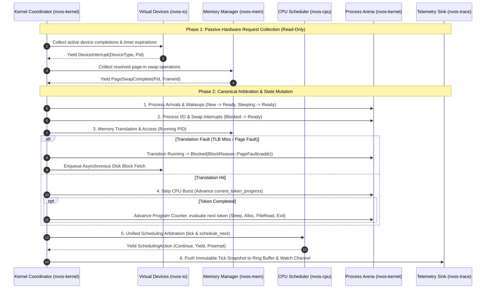

# Subsystem Specification 01: Kernel Core, PCB & Panic Isolation

* **Module:** `nvos-core` / `nvos-kernel`
* **Parent Architecture:** [nvos_simulator.md](../nvos_simulator.md)
* **Status:** Approved Specification

---

## 1. Executive Responsibilities

The kernel core establishes the foundational execution model of `nvos`:
1. **Deterministic Discrete-Event Engine:** Drives a virtual clock (`Tick(u64)`) where time advances deterministically by event intervals or active burst ticks, eliminating all host wall-clock jitter.
2. **Two-Phase Commit Tick Cycle:** Enforces a strict separation between passive hardware request collection (Phase 1) and canonical state mutation / scheduling arbitration (Phase 2).
3. **Tanenbaum Process Control Block (PCB):** Models complete OS process table semantics with decoupled opaque handles.
4. **Resumable Instruction Tape:** Tracks synthetic burst tokens with intra-token progress counters to guarantee deterministic preemption and resumption.
5. **Two-Tier Error Taxonomy & Panic Boundary:** Isolates pluggable student/user algorithms in a safe panic containment harness (`SimulatedKernelPanic`), preventing host process crashes.

---

## 2. The Two-Phase Commit Tick Cycle

To eliminate intra-tick circular cascades (e.g., page fault triggering disk I/O, which invokes context switching and modifies scheduler queues), the tick evaluation loop strictly divides work into two phases:



### Critical Invariant: No Scheduling in Phase 1
Schedulers are **never** evaluated in Phase 1. Evaluating preemption before processing arrivals or I/O completion interrupts causes stale scheduling decisions and race conditions. All scheduling logic occurs in Step 5 of Phase 2 after all queues are updated.

---

## 3. Process Control Block & Memory Decoupling

`nvos-core` defines the PCB using opaque primitive identifier types to prevent cyclic crate dependencies with downstream subsystems (`nvos-mem`, `nvos-io`, `nvos-fs`).

### 3.1. PCB Layout (`crates/nvos-core/src/process.rs`)
```rust
use crate::tick::Tick;
use std::collections::BTreeMap;

#[derive(Debug, Clone, Copy, PartialEq, Eq, PartialOrd, Ord, Hash)]
pub struct Pid(pub u32);

#[derive(Debug, Clone, Copy, PartialEq, Eq, PartialOrd, Ord)]
pub struct PriorityLevel(pub u8);

#[derive(Debug, Clone, Copy, PartialEq, Eq, Hash)]
pub struct PageTableId(pub u32);

#[derive(Debug, Clone, Copy, PartialEq, Eq, Hash)]
pub struct HeapBlockId(pub u32);

#[derive(Debug, Clone, Copy, PartialEq, Eq, Hash)]
pub struct FileDescriptor(pub u32);

#[derive(Debug, Clone, Copy, PartialEq, Eq, Hash)]
pub struct InodeId(pub u32);

#[derive(Debug, Clone, PartialEq, Eq)]
pub struct ProcessControlBlock {
    // Process Identification
    pub pid: Pid,
    pub ppid: Option<Pid>,
    pub name: String,

    // State & Priority
    pub state: ProcessState,
    pub priority: PriorityLevel,
    pub base_priority: PriorityLevel,
    pub quantum_remaining: u32,

    // CPU Accounting & Program Counter (Tanenbaum model)
    pub program_counter: usize,
    pub current_token_progress: u32,
    pub cpu_time_consumed: u64,
    pub arrival_tick: Tick,
    pub completion_tick: Option<Tick>,

    // Decoupled Subsystem Handles
    pub page_table_root: Option<PageTableId>,
    pub allocated_heap_blocks: Vec<HeapBlockId>,
    pub file_descriptors: BTreeMap<FileDescriptor, InodeId>,

    // Instruction Burst Tape
    pub execution_tape: Vec<InstructionToken>,
}
```

### 3.2. Canonical Process Lifecycle States
```rust
#[derive(Debug, Clone, PartialEq, Eq)]
pub enum ProcessState {
    New,
    Ready,
    Running,
    Blocked(BlockReason),
    Sleeping(Tick), // Awakening target tick
    Terminated(ExitReason),
}

#[derive(Debug, Clone, PartialEq, Eq)]
pub enum BlockReason {
    Io { device_id: u32, request_id: u64 },
    PageFault { virtual_addr: u32 },
}

#[derive(Debug, Clone, PartialEq, Eq)]
pub enum ExitReason {
    Normal(i32),
    SegmentationFault { address: u32 },
    IllegalInstruction,
    QuantumExhaustionTrap,
    Killed,
}
```

---

## 4. Resumable Instruction Tape

Each process executes a synthetic sequence of operations:

```rust
#[derive(Debug, Clone, PartialEq, Eq)]
pub enum InstructionToken {
    /// Consumes N CPU execution ticks. Resumes deterministically via current_token_progress.
    Cpu(u32),
    /// Requests dynamic heap allocation of size bytes.
    Alloc { bytes: usize },
    /// Frees previously allocated heap block.
    Free { block_id: HeapBlockId },
    /// Virtual memory read (triggers TLB and Page Table translation).
    MemoryRead { virtual_addr: u32 },
    /// Virtual memory write.
    MemoryWrite { virtual_addr: u32 },
    /// Read N bytes from file descriptor (initiates timed disk DMA transfer).
    FileRead { fd: FileDescriptor, bytes: usize },
    /// Write N bytes to file descriptor.
    FileWrite { fd: FileDescriptor, bytes: usize },
    /// Explicit sleep for N ticks.
    Sleep(u32),
    /// Deterministic fault injection for chaos testing.
    FaultInject { target: FaultTarget, error_code: u32 },
    /// Process termination.
    Exit(i32),
}

#[derive(Debug, Clone, Copy, PartialEq, Eq)]
pub enum FaultTarget {
    DiskReadError,
    MemoryEccError,
    SpuriousInterrupt,
}
```

### Tape Progression Semantics
1. When a process runs, it inspects `execution_tape[program_counter]`.
2. For multi-tick instructions (`Cpu(duration)`):
   - `current_token_progress += 1`.
   - If `current_token_progress < duration`, the process remains `Running` (or yields if quantum expires).
   - Once `current_token_progress == duration`, the token is retired: `program_counter += 1` and `current_token_progress = 0`.
3. If `program_counter >= execution_tape.len()` without an explicit `Exit`, the kernel automatically triggers `ExitReason::Normal(0)`.

---

## 5. Two-Tier Error Model & Panic Isolation

### 5.1. Error Hierarchy (`crates/nvos-core/src/error.rs`)
The system strictly distinguishes between **Guest OS Traps** (normal educational simulation conditions) and **Host Engine Invariants**:

```rust
/// Tier 1: Recoverable Guest OS Traps & Policy Failures
#[derive(Debug, Clone, PartialEq, Eq)]
pub enum GuestTrap {
    PageFault { virtual_addr: u32 },
    IllegalAccess { address: u32 },
    FileNotFound { fd: FileDescriptor },
    OutOfMemory,
}

/// Tier 2: Unrecoverable Host Engine Violations
#[derive(Debug, thiserror::Error)]
pub enum KernelEngineError {
    #[error("Process arena corruption for PID {0:?}")]
    InvalidProcessHandle(Pid),
    #[error("Non-monotonic discrete clock transition: current {current:?}, attempted {attempted:?}")]
    ClockMonotonicityViolation { current: Tick, attempted: Tick },
    #[error("Subsystem fatal failure in {subsystem}: {message}")]
    SubsystemFailure { subsystem: &'static str, message: String },
}
```

### 5.2. Panic Isolation Boundary ("Virtual BSoD") (`crates/nvos-kernel/src/panic_boundary.rs`)
Pluggable student/researcher schedulers and memory allocators are wrapped in `catch_unwind`:

```rust
use std::panic::{catch_unwind, AssertUnwindSafe};

pub fn safe_subsystem_dispatch<F, R>(
    subsystem_name: &'static str,
    action: F,
) -> Result<R, SimulationError>
where
    F: FnOnce() -> Result<R, SimulationError>,
{
    match catch_unwind(AssertUnwindSafe(action)) {
        Ok(result) => result,
        Err(panic_payload) => {
            let msg = if let Some(s) = panic_payload.downcast_ref::<&str>() {
                s.to_string()
            } else if let Some(s) = panic_payload.downcast_ref::<String>() {
                s.clone()
            } else {
                "Unknown panic payload".to_string()
            };

            Err(SimulationError::SimulatedKernelPanic {
                subsystem: subsystem_name,
                reason: msg,
                backtrace: std::backtrace::Backtrace::capture().to_string(),
            })
        }
    }
}
```
If a user policy panics, the simulator core enters `SimulationStatus::Halted(SimulatedKernelPanic)`. It captures a diagnostic snapshot into `nvos-trace`, rendering a clean panic report in the TUI/Web UI without terminating the host process.
