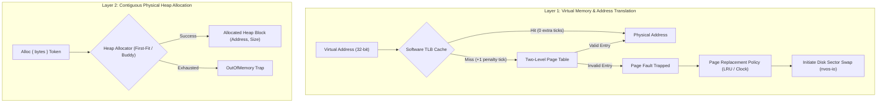

# Subsystem Specification 03: Dual-Layer Memory Management

* **Module:** `nvos-mem`
* **Parent Architecture:** [nvos_simulator.md](../nvos_simulator.md)
* **Status:** Approved Specification

---

## 1. Executive Responsibilities

The `nvos-mem` crate simulates a complete, dual-layer operating system memory hierarchy:
1. **Layer 1: Virtual Memory & Paging Subsystem:** Implements two-level hierarchical page tables, a configurable software Translation Lookaside Buffer (TLB), page fault generation, and pluggable page replacement policies (FIFO, LRU, Second-Chance Clock).
2. **Layer 2: Physical Contiguous Heap Allocation:** Implements contiguous physical memory allocation algorithms (First-Fit, Best-Fit, and binary Buddy Allocator) to evaluate internal and external fragmentation under realistic workloads.
3. **Formal Invariant Verification:** Verified via property-based fuzzing to guarantee address uniqueness, zero block overlap, and total frame conservation.

---

## 2. Core Architecture: Dual-Layer Memory Hierarchy



---

## 3. Core Trait Contracts

### 3.1. Memory Management Contract (`crates/nvos-mem/src/lib.rs`)
```rust
use nvos_core::process::{HeapBlockId, Pid};

#[derive(Debug, Clone, Copy, PartialEq, Eq)]
pub struct VirtualAddress(pub u32);

#[derive(Debug, Clone, Copy, PartialEq, Eq)]
pub struct PhysicalAddress(pub u32);

#[derive(Debug, Clone, Copy, PartialEq, Eq)]
pub struct FrameId(pub u32);

#[derive(Debug, Clone, PartialEq, Eq)]
pub struct HeapBlock {
    pub id: HeapBlockId,
    pub base_addr: PhysicalAddress,
    pub size_bytes: usize,
}

#[derive(Debug, thiserror::Error)]
pub enum MemoryError {
    #[error("Physical memory exhausted: requested {requested} bytes, available {available} bytes")]
    OutOfMemory { requested: usize, available: usize },
    #[error("Invalid heap block ID {0:?}")]
    InvalidBlockId(HeapBlockId),
    #[error("Page table root missing for PID {0:?}")]
    MissingPageTable(Pid),
}

#[derive(Debug, Clone, PartialEq, Eq)]
pub enum MemoryFault {
    PageFault { pid: Pid, virtual_addr: VirtualAddress },
    ProtectionViolation { pid: Pid, virtual_addr: VirtualAddress },
}

pub trait MemoryManager: Send + Sync {
    /// Name of the active memory management configuration.
    fn name(&self) -> &'static str;

    // --- Layer 1: Virtual Memory & TLB ---
    /// Translate a virtual address to physical address via TLB and Page Table.
    fn translate(&mut self, pid: Pid, virtual_addr: VirtualAddress) -> Result<PhysicalAddress, MemoryFault>;

    /// Evict a victim frame according to the active replacement policy and prepare page-in.
    fn handle_page_fault(&mut self, fault: MemoryFault) -> Result<FrameId, MemoryError>;

    // --- Layer 2: Physical Contiguous Heap ---
    /// Allocate contiguous physical heap memory.
    fn allocate_heap(&mut self, pid: Pid, size_bytes: usize) -> Result<HeapBlock, MemoryError>;

    /// Free previously allocated contiguous heap memory.
    fn free_heap(&mut self, pid: Pid, block_id: HeapBlockId) -> Result<(), MemoryError>;

    /// Inspect current external and internal fragmentation metrics.
    fn fragmentation_metrics(&self) -> FragmentationReport;
}
```

---

## 4. Subsystem Implementations

### 4.1. Software TLB & Two-Level Paging
* **Virtual Address Format (32-bit):**
  - Bits `[31..22]` (10 bits): Page Directory Index ($1024$ entries).
  - Bits `[21..12]` (10 bits): Page Table Index ($1024$ entries).
  - Bits `[11..0]` (12 bits): Byte Offset inside $4\text{ KB}$ Page.
* **Software TLB Cache:** Configurable direct-mapped or fully-associative cache ($4, 8, 16$ entries).
  - TLB Hit: $0$ latency ticks.
  - TLB Miss: $+1$ memory access tick penalty to walk the two-level page table.

### 4.2. Page Replacement Policies
* **FIFO (First-In, First-Out):** Evicts the oldest page frame brought into physical memory.
* **LRU (Least Recently Used):** Tracks last-access discrete ticks (`last_accessed: Tick`) on physical frames; evicts the frame with the oldest timestamp.
* **Clock Algorithm (Second Chance):** Utilizes a circular frame buffer with a single `use_bit: bool` and moving clock hand pointer. Gives pages a second chance before eviction.

### 4.3. Contiguous Physical Heap Allocators
* **First-Fit Allocator:** Scans the free list from the beginning and allocates the first contiguous free block large enough.
* **Best-Fit Allocator:** Scans the entire free list to find the free block whose size is closest to the request, minimizing wasted remainder.
* **Binary Buddy Allocator:** Partitions physical memory into powers of two ($2^k$). When a block is freed, it checks if its buddy is free and merges them recursively, eliminating external fragmentation at the cost of internal fragmentation.

---

## 5. Verification Harness: Property Testing

### 5.1. Allocator Invariant Verification (`crates/nvos-mem/tests/allocator_proptests.rs`)
Using `proptest`, we generate arbitrary randomized allocate and free sequences:

```rust
// Property: Frame Conservation Invariant
// At every point in execution, the sum of allocated frames and free frames
// must strictly equal the physical frame pool capacity.
prop_assert_eq!(
    allocator.allocated_frames() + allocator.free_frames(),
    allocator.total_physical_capacity()
);

// Property: Zero Block Overlap
// No two actively allocated heap blocks may overlap in physical address space.
for i in 0..active_blocks.len() {
    for j in (i + 1)..active_blocks.len() {
        prop_assert!(!active_blocks[i].overlaps(&active_blocks[j]));
    }
}
```
