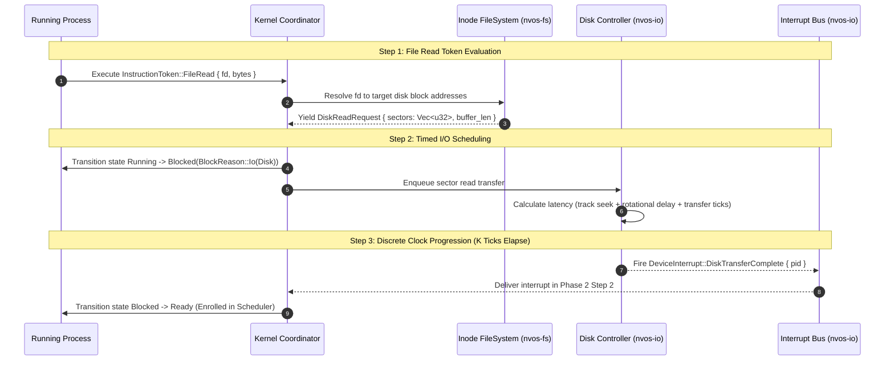

# Subsystem Specification 04: Mock Inode Filesystem & Virtual I/O Devices

* **Modules:** `nvos-fs` / `nvos-io`
* **Parent Architecture:** [nvos_simulator.md](../nvos_simulator.md)
* **Status:** Approved Specification

---

## 1. Executive Responsibilities

1. **Unix-Style Inode Filesystem (`nvos-fs`):** Implements an in-memory hierarchical storage model with superblocks, free-block bitmaps, inode allocation tables, direct block pointers ($0..11$), and single/double indirect addressing.
2. **Discrete Timed I/O Decoupling:** Reconciles the filesystem with discrete simulation time by separating **instant metadata resolution** (path to inode, inode to sector blocks in zero ticks) from **timed physical block access** (simulated disk seek and DMA transfer latencies in ticks).
3. **Virtual Device Controllers (`nvos-io`):** Models virtual timers, DMA controllers, and storage devices emitting discrete completion interrupts.

---

## 2. Architecture: Filesystem & Timed I/O Separation



---

## 3. Mock Inode Filesystem Contracts (`crates/nvos-fs/src/lib.rs`)

### 3.1. Inode Data Structure
```rust
use nvos_core::process::{FileDescriptor, InodeId, Pid};

pub const DIRECT_BLOCKS_COUNT: usize = 12;
pub const BLOCK_SIZE: usize = 512;

#[derive(Debug, Clone, PartialEq, Eq)]
pub struct Inode {
    pub id: InodeId,
    pub file_size_bytes: u64,
    pub permissions: u16,
    pub links_count: u16,
    
    // Direct block addresses (0..11)
    pub direct_blocks: [Option<u32>; DIRECT_BLOCKS_COUNT],
    // Single indirect block pointer (points to block of u32 sector IDs)
    pub single_indirect: Option<u32>,
    // Double indirect block pointer
    pub double_indirect: Option<u32>,
}
```

### 3.2. FileSystem Trait
```rust
#[derive(Debug, thiserror::Error)]
pub enum FsError {
    #[error("File not found: {0}")]
    NotFound(String),
    #[error("Invalid file descriptor: {0:?}")]
    InvalidFd(FileDescriptor),
    #[error("Disk full: no free blocks available")]
    DiskFull,
    #[error("Inode table exhausted")]
    NoFreeInodes,
}

pub trait FileSystem: Send + Sync {
    /// Create a file in the mock directory hierarchy.
    fn create_file(&mut self, path: &str, permissions: u16) -> Result<InodeId, FsError>;

    /// Open a file and allocate a process file descriptor.
    fn open(&mut self, pid: Pid, path: &str) -> Result<FileDescriptor, FsError>;

    /// Close an open file descriptor.
    fn close(&mut self, pid: Pid, fd: FileDescriptor) -> Result<(), FsError>;

    /// Resolve an open file descriptor to a list of disk sector block IDs for timed read.
    fn resolve_read_blocks(&self, fd: FileDescriptor, offset: usize, len: usize) -> Result<Vec<u32>, FsError>;

    /// Allocate disk blocks and write payload into in-memory mock block storage.
    fn write_blocks(&mut self, fd: FileDescriptor, offset: usize, data: &[u8]) -> Result<Vec<u32>, FsError>;
}
```

---

## 4. Virtual Device Controllers & Interrupt Bus (`crates/nvos-io/src/lib.rs`)

### 4.1. Virtual Disk Controller (`crates/nvos-io/src/disk_controller.rs`)
The disk controller calculates realistic simulated sector access times deterministically using the seedable PRNG (`rand_chacha`):
$$\text{LatencyTicks} = \text{SeekTicks}(\Delta\text{cylinder}) + \text{RotationalDelayTicks} + (\text{SectorCount} \times \text{TransferRate})$$

```rust
use nvos_core::process::Pid;
use nvos_core::tick::Tick;

#[derive(Debug, Clone, PartialEq, Eq)]
pub struct DiskTransferRequest {
    pub pid: Pid,
    pub target_sectors: Vec<u32>,
    pub completion_tick: Tick,
}

pub struct VirtualDiskController {
    pub current_head_cylinder: u32,
    pub pending_queue: Vec<DiskTransferRequest>,
}

impl VirtualDiskController {
    pub fn schedule_transfer(&mut self, pid: Pid, sectors: Vec<u32>, current_tick: Tick) -> Tick {
        let seek_ticks = (sectors[0] / 32).abs_diff(self.current_head_cylinder) as u64;
        let transfer_ticks = sectors.len() as u64 * 2;
        let total_latency = seek_ticks + transfer_ticks + 5; // Fixed rotation floor
        
        let completion_tick = current_tick + total_latency;
        self.pending_queue.push(DiskTransferRequest {
            pid,
            target_sectors: sectors,
            completion_tick,
        });
        completion_tick
    }

    pub fn poll_completions(&mut self, current_tick: Tick) -> Vec<Pid> {
        let (completed, remaining) = self.pending_queue.drain(..).partition(|r| r.completion_tick <= current_tick);
        self.pending_queue = remaining;
        completed.into_iter().map(|r| r.pid).collect()
    }
}
```

### 4.2. Programmable Interval Timer (`crates/nvos-io/src/timer.rs`)
Emits periodic hardware interrupts at a configurable tick frequency (e.g., every 1 tick) to drive kernel preemption and quantum expiration checks.
