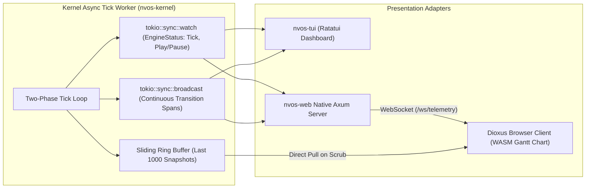

# Subsystem Specification 05: Telemetry, Ratatui TUI & Dioxus Web UI

* **Modules:** `nvos-trace` / `nvos-tui` / `nvos-web`
* **Parent Architecture:** [nvos_simulator.md](../nvos_simulator.md)
* **Status:** Approved Specification

---

## 1. Executive Responsibilities

1. **Bounded Telemetry Ring Buffer (`nvos-trace`):** Maintains the last $N = 1000$ full simulation state snapshots in memory (~10–20 MB RAM footprint), enabling instantaneous time-travel stepping without complex inverse mutation logs.
2. **Terminal User Interface (`nvos-tui`):** High-density split-pane terminal dashboard built with `ratatui` running at 60 FPS on the terminal event thread.
3. **Pure-Rust Web Application (`nvos-web`):** Pure-Rust frontend built with **Dioxus** rendering an interactive SVG/Canvas Gantt chart plotting PID states across discrete `Tick(u64)` timestamps.
4. **Dual-Target Compilation Architecture:** Cleanly separates native host Axum HTTP/WebSocket server capabilities from browser WebAssembly (`wasm32-unknown-unknown`) compilation using Cargo target-conditional dependencies.

---

## 2. Telemetry Pipeline & Lossless Stream Architecture



### YAGNI Resolution: Rejection of Inverse Mutation Logs
Earlier brainstorm reviews explored delta-snapshotting with reverse mutations (`KernelMutationInverse`). This has been **firmly rejected as over-engineering**. Full snapshots of 50 processes in a 1,000-tick ring buffer consume less than 20 MB of memory. A simple contiguous slice pull (`last_rendered_tick..current_tick`) from the ring buffer guarantees zero dropped Gantt spans with minimal code complexity.

---

## 3. Dual-Target Compilation in `nvos-web`

To prevent compilation deadlocks when building for native desktop CLI vs. browser WebAssembly, `crates/nvos-web/Cargo.toml` employs strict target-conditional configuration:

```toml
[package]
name = "nvos-web"
version = "0.1.0"
edition = "2024"

[dependencies]
nvos-core = { path = "../nvos-core", features = ["serde"] }
serde = { workspace = true, features = ["derive"] }
serde_json = { workspace = true }

# Native Host Build: Embedded Axum Server & Asset Bundler
[target.'cfg(not(target_arch = "wasm32"))'.dependencies]
axum = { workspace = true, features = ["ws"] }
tokio = { workspace = true, features = ["full"] }
tower-http = { workspace = true, features = ["fs", "cors"] }
rust-embed = "8.5"

# Browser WASM Build: Dioxus Single-Page App
[target.'cfg(target_arch = "wasm32")'.dependencies]
dioxus = { workspace = true }
dioxus-web = { workspace = true }
web-sys = { version = "0.3", features = ["WebSocket", "MessageEvent"] }
```

### Static Asset Packaging (`crates/nvos-web/src/assets.rs`)
In native builds, the compiled Dioxus client WASM/HTML/CSS assets are embedded directly into the binary using `rust-embed`:
```rust
#[cfg(not(target_arch = "wasm32"))]
use rust_embed::RustEmbed;

#[cfg(not(target_arch = "wasm32"))]
#[derive(RustEmbed)]
#[folder = "dist/"]
pub struct WebAssets;
```
Running `nvos web <scenario.toml> --port 8080` serves the embedded Dioxus single-page app without requiring any local node/npm runtime or separate web assets directory.

---

## 4. Dioxus SVG Gantt Chart Implementation

The Gantt chart plots time on the horizontal axis (`Tick(u64)`) against Process IDs (`Pid`) on vertical lanes:

```rust
use dioxus::prelude::*;
use nvos_core::process::{Pid, ProcessState};
use nvos_core::tick::Tick;

#[derive(Props, Clone, PartialEq)]
pub struct GanttProps {
    pub execution_spans: Vec<ExecutionSpan>,
    pub current_tick: Tick,
    pub zoom_scale_px: f64,
}

#[derive(Clone, PartialEq)]
pub struct ExecutionSpan {
    pub pid: Pid,
    pub start_tick: Tick,
    pub end_tick: Tick,
    pub state: ProcessState,
}

#[component]
pub fn GanttChart(props: GanttProps) -> Element {
    let row_height = 36.0;
    let tick_scale = props.zoom_scale_px;

    rsx! {
        div { class: "gantt-container overflow-x-auto border border-gray-700 bg-gray-900 rounded p-4",
            svg {
                width: "{props.current_tick.0 as f64 * tick_scale + 200.0}",
                height: "400",
                // Tick Coordinate Axis
                line { x1: "0", y1: "30", x2: "2000", y2: "30", stroke: "#4B5563" }
                // Render Execution Slices per PID
                for span in props.execution_spans.iter() {
                    rect {
                        x: "{(span.start_tick.0 as f64) * tick_scale}",
                        y: "{(span.pid.0 as f64) * row_height + 40.0}",
                        width: "{((span.end_tick.0 - span.start_tick.0) as f64) * tick_scale}",
                        height: "{row_height - 6.0}",
                        rx: "4",
                        fill: match &span.state {
                            ProcessState::Running => "#10B981",    // Emerald
                            ProcessState::Ready => "#3B82F6",      // Blue
                            ProcessState::Blocked(_) => "#F59E0B", // Amber
                            ProcessState::Sleeping(_) => "#8B5CF6",// Purple
                            ProcessState::Terminated(_) => "#6B7280", // Gray
                            _ => "#374151",
                        }
                    }
                }
            }
        }
    }
}
```

---

## 5. Ratatui Terminal Interface Layout (`nvos-tui`)

The terminal dashboard is rendered using `ratatui` with a high-density 5-pane layout:

```text
+-----------------------------------------------------------------------------+
| nvos - Deterministic Discrete-Event OS Simulator              Tick: 000142 |
+------------------------------------+----------------------------------------+
| CPU Core & Scheduling              | Dual-Layer Memory Management           |
| Active PID: 003 [Tape: Cpu(2/5)]   | Physical Frames: [■■■■■■■■□□□□□□□□] 50%|
| Quantum Bar: [██████░░░░] 6/10     | TLB Hits: 1,420 | Misses: 38 (97.4%)   |
| Ready Queue: [PID 001, PID 004]    | Active Policy: Clock (Second Chance)   |
+------------------------------------+----------------------------------------+
| Mock Inode Filesystem & I/O        | Live Filtered Trace Log                |
| Inodes Used: 14 / 128 (10.9%)      | [000140] [SYS] Disk DMA read done -> P1|
| Disk Queue: [Read Sector 102 (P2)] | [000141] [SCHED] Context switch: P3->P1|
| Storage Latency: 12 ticks remain   | [000142] [MEM] TLB hit at 0x0040_1000  |
+------------------------------------+----------------------------------------+
| Controls: [Space] Pause/Run | [n] Next Tick | [p] Step Back | [q] Quit     |
+-----------------------------------------------------------------------------+
```
Running completely inside a dedicated terminal loop, keyboard inputs update engine parameters without blocking or desynchronizing the deterministic discrete-event core.
