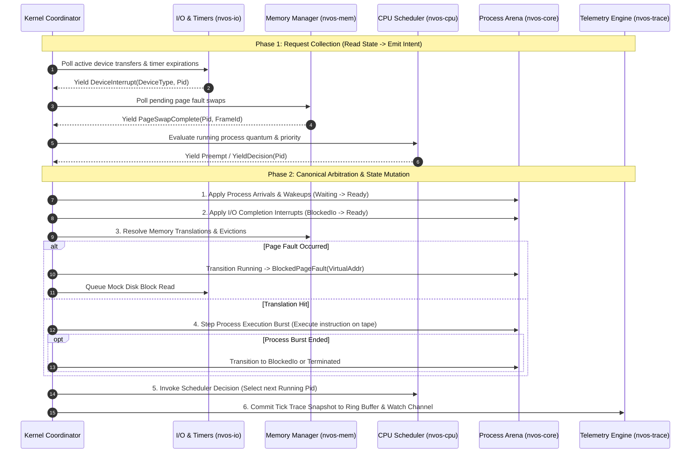
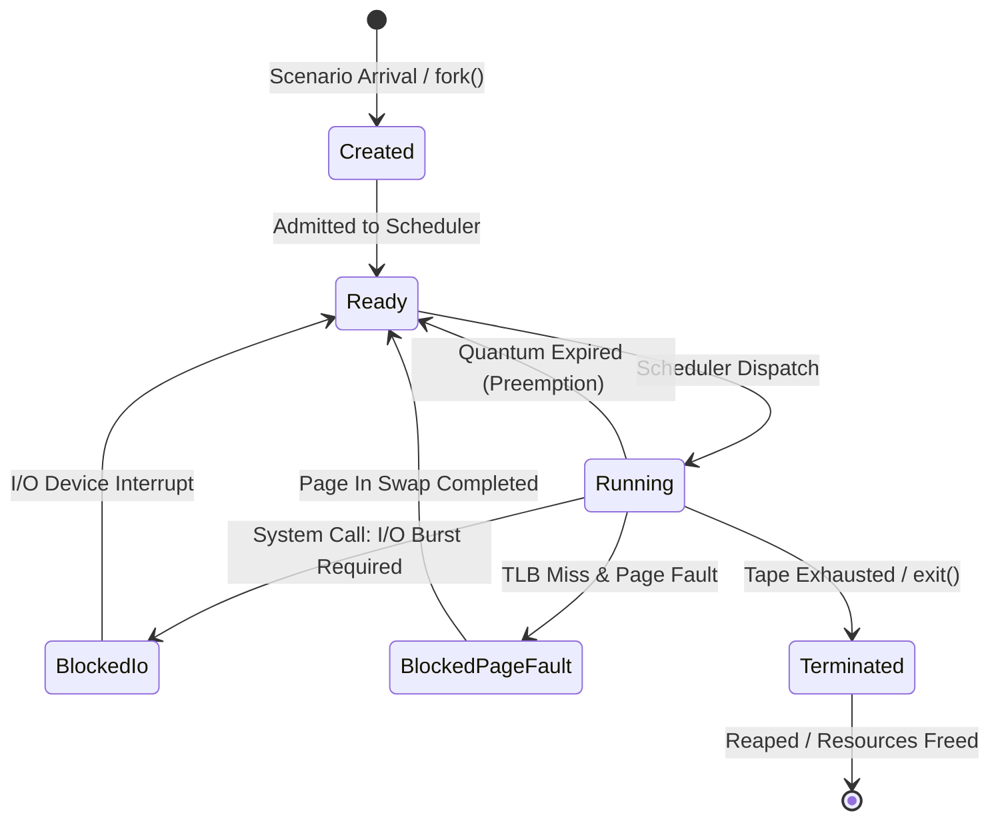
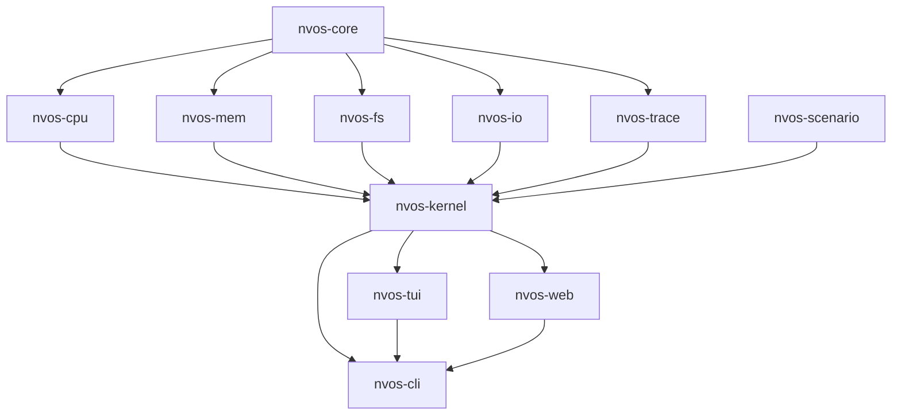
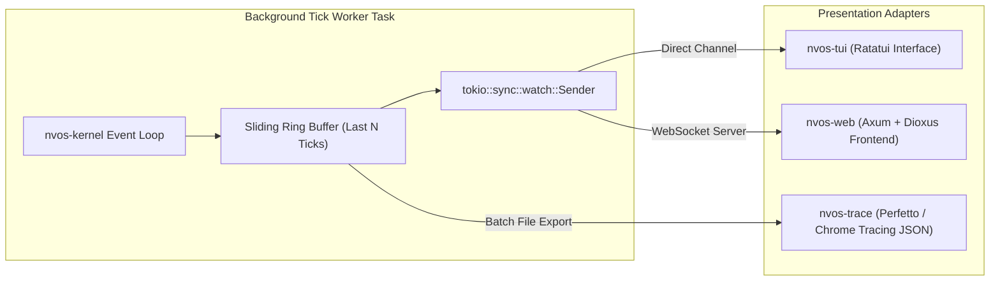

# Technical Design Document: nvos (Deterministic Discrete-Event OS Simulator)

* **Author:** cristiano-s-r-filho
* **Date:** 2026-11-18
* **Status:** Draft

---

## 1. The Problem

Operating systems education and algorithmic research require inspecting complex interactions between CPU scheduling, memory hierarchy management, filesystem operations, and asynchronous I/O devices. However, existing approaches present major pedagogical and engineering pain points:

1. **Non-Determinism in Real Concurrency:** Simulating operating system primitives using standard OS threads, asynchronous timers, or wall-clock intervals introduces non-deterministic race conditions, thread scheduling jitter, and reproducibility failures. Reproducing an edge case (such as a priority inversion or a race between an I/O completion interrupt and a page fault) across runs or student submissions becomes virtually impossible.
2. **Subsystem Entanglement in Monoliths:** Traditional educational operating systems (such as xv6 or Pintos) couple process management, page tables, disk drivers, and schedulers tightly into a monolithic kernel. Evaluating an isolated component (e.g., comparing the throughput of Multi-Level Feedback Queue against Round Robin, or measuring fragmentation in a Buddy Allocator) requires running the entire kernel, making isolated benchmarking and unit testing cumbersome.
3. **Observability and Telemetry Gap:** Most educational simulators output unstructured stdout logs. When tracing multiple processes interleaving across CPU bursts, disk seeks, and page replacement cycles, text logs fail to convey temporal relationships. Debugging requires visual timeline alignment (Gantt charts) and step-by-step interactive inspection, which standard CLI tools lack.
4. **Toolchain Fragmentation:** Existing simulators with graphical visualization often split the implementation across different languages (e.g., a C kernel with a Python/Tkinter or JavaScript/React frontend), introducing foreign function interfaces (FFI), node/npm dependencies, and cross-compilation friction.

## 2. Overview

`nvos` is a modular, pure-Rust discrete-event operating system simulator engineered to solve these challenges. It provides a deterministic simulation environment where processes—modeled after Andrew S. Tanenbaum's classic Process Control Block (PCB) specification—execute abstract instruction bursts against simulated hardware subsystems:

* **Discrete-Event Kernel (`nvos-kernel`):** A deterministic event-driven core driven by a virtual clock (`Tick(u64)`). The simulator eliminates wall-clock time and non-deterministic hashing, ensuring 100% reproducible execution traces given the same seed and scenario.
* **Decoupled Architecture:** Subsystems (CPU scheduling, dual-layer memory management, mock inode-based filesystem, and I/O devices) are organized as independent crates in a Cargo workspace. Each subsystem implements clean trait contracts with dual interfaces: a direct procedural API for zero-overhead unit testing, and a message-driven adapter for integrated kernel loop execution.
* **Two-Phase Commit Tick Loop:** To prevent circular event cascades and deadlocks within a single discrete tick, the kernel separates state evaluation from mutation. Subsystems collect and emit requests during Phase 1, and the kernel arbitrates and applies mutations in canonical priority order during Phase 2.
* **Tiered Telemetry & Sliding Window:** The engine emits structured telemetry bounded by a configurable in-memory ring buffer (sliding window of $N$ ticks) for interactive time-travel debugging and TUI stepping, while streaming compacted checkpoint logs to disk.
* **Dual Pure-Rust Interfaces:**
  * **Interactive TUI (`nvos-tui`):** A high-density terminal dashboard built with `ratatui` for local command-line inspection and single-tick stepping.
  * **Visual Web Dashboard (`nvos-web`):** A pure-Rust web frontend built with **Dioxus**, offering live WebSocket telemetry streaming, system controls, and an interactive **Gantt Chart** plotting process states against discrete tick timestamps.

## 3. Goals

* **Strict Reproducibility:** Ensure all simulation runs produce identical state sequences and event logs for any given scenario seed and configuration.
* **Pedagogical Fidelity to Tanenbaum's Modern OS:** Model Process Control Blocks with realistic process table fields: PID, PPID, registers, state transitions, CPU usage accounting, priority levels, memory limits, and open file descriptors.
* **Pluggable Subsystem Policies:** Enable users to implement and test alternative algorithms via standalone Rust traits without modifying kernel harness code:
  * *CPU Schedulers:* First-Come First-Served (FCFS), Round Robin (RR) with preemption, Shortest Job First / Shortest Remaining Time First (SJF/SRTF), and Multi-Level Feedback Queue (MLFQ).
  * *Memory Allocators:* Paging with page replacement (FIFO, LRU, Clock) alongside contiguous physical heap allocation (First-Fit, Best-Fit, Buddy Allocator).
* **Mock Inode Storage Engine:** Model an in-memory Unix-style filesystem with superblocks, inode allocation bitmaps, direct and indirect block pointers, and file descriptor resolution.
* **Interrupt and DMA Simulation:** Model timer interrupts, disk controller DMA transfers, and peripheral I/O latencies deterministically in ticks.
* **Zero-FFI, Pure-Rust Ecosystem:** Implement the entire stack—from kernel core to the TUI and Dioxus Web UI—in 100% safe Rust without external C/JS runtimes.
* **Automated Scenarios and Testing:** Provide declarative TOML scenario files to script process arrival, burst sequences, and memory footprints for reproducible benchmarking and automated grading.

## 4. Non-Goals

* **Hardware Architecture Emulation:** No binary execution of x86, ARM, or RISC-V machine instructions. Processes execute abstract synthetic burst tokens, not raw assembly.
* **Host Operating System Thread Mapping:** Simulated processes do not map to host OS threads (`std::thread`). Concurrency is strictly discrete and event-driven.
* **POSIX Compliance:** Syscalls, filesystem semantics, and error codes are simplified educational models, not a certified POSIX implementation.
* **Production Driver Integration:** No interaction with real physical hardware devices or host kernel async I/O subsystems (`io_uring`, `epoll`).
* **Multi-Node Distributed OS Simulation:** The simulator models a single-node computing system; distributed scheduling and network consensus are out of scope.

---

## 5. Technical Plan

### 5.1. System Architecture & The Two-Phase Tick Cycle

The simulator operates as a deterministic discrete-event state machine coordinated by `nvos-kernel`. Time progresses in discrete units: `Tick(u64)`.

To eliminate intra-tick race conditions and circular cascades between subsystems (such as a page fault needing disk blocks, which schedules an I/O request, which triggers a context switch and modifies scheduler queues), `nvos` executes each tick in a **Two-Phase Commit**:



### 5.2. Process Control Block (PCB) & State Machine "Tape"

`nvos` structures process representation around the classical operating systems literature (Tanenbaum's process management model):

#### 5.2.1. Process Control Block Layout (`nvos-core`)
```rust
#[derive(Debug, Clone, PartialEq, Eq)]
pub struct ProcessControlBlock {
    // Identification
    pub pid: Pid,
    pub ppid: Option<Pid>,
    pub name: String,

    // Process State & Scheduling
    pub state: ProcessState,
    pub priority: PriorityLevel,
    pub base_priority: PriorityLevel,
    pub quantum_remaining: u32,
    
    // CPU Registers & Accounting (Tanenbaum model)
    pub program_counter: usize,
    pub cpu_time_consumed: u64,
    pub arrival_tick: Tick,
    pub completion_tick: Option<Tick>,

    // Memory Space (Dual-Layer)
    pub memory_limits: MemoryLimits,
    pub page_table_root: Option<PageTableId>,
    pub allocated_heap_blocks: Vec<HeapBlockId>,

    // I/O & Filesystem
    pub file_descriptors: BTreeMap<FileDescriptor, InodeId>,
    pub pending_io: Option<PendingIoRequest>,

    // Instruction Tape
    pub execution_tape: Vec<InstructionToken>,
}
```

#### 5.2.2. Process State Machine & Transitions
Processes transition through well-defined operational states:



#### 5.2.3. Synthetic Instruction Tape
Rather than executing raw machine code, each process carries an **Instruction Tape** (`Vec<InstructionToken>`) parsed from scenario files:
```rust
#[derive(Debug, Clone, PartialEq, Eq)]
pub enum InstructionToken {
    /// Consumes N CPU execution ticks without blocking.
    Cpu(u32),
    /// Requests dynamic memory heap allocation of size bytes.
    Alloc { bytes: usize },
    /// Frees previously allocated memory block.
    Free { block_id: usize },
    /// Memory read at virtual address (triggers TLB/Paging lookup).
    MemoryRead { virtual_addr: u32 },
    /// Memory write at virtual address.
    MemoryWrite { virtual_addr: u32 },
    /// Read N bytes from file descriptor (triggers I/O latency & block lookup).
    FileRead { fd: FileDescriptor, bytes: usize },
    /// Write N bytes to file descriptor.
    FileWrite { fd: FileDescriptor, bytes: usize },
    /// Explicit sleep/delay for N ticks.
    Sleep(u32),
    /// Process completion.
    Exit(i32),
}
```

### 5.3. Workspace Decomposition & Crate Boundaries

```text
nvos/
├── Cargo.toml                       # Virtual workspace root
├── crates/
│   ├── nvos-core/                   # Core types: Tick, Pid, ProcessState, PCB, InstructionToken
│   ├── nvos-cpu/                    # Schedulers: Scheduler trait, FCFS, RR, MLFQ, SJF
│   ├── nvos-mem/                    # Memory: FrameAllocator, PageTable, TLB, Policies (LRU, Clock, Buddy)
│   ├── nvos-fs/                     # Inode filesystem: Superblock, InodeTable, MockBlockDevice
│   ├── nvos-io/                     # Virtual devices: Timer, DiskController, InterruptBus
│   ├── nvos-kernel/                 # Discrete-event engine, Two-Phase Tick Orchestrator
│   ├── nvos-trace/                  # Ring-buffer telemetry, Chrome Tracing/Perfetto & NDJSON exporters
│   ├── nvos-scenario/               # Declarative TOML scenario parser & workload generator
│   ├── nvos-tui/                    # Ratatui terminal dashboard & interactive controller
│   ├── nvos-web/                    # Dioxus pure-Rust web app (WASM/Desktop) with dynamic Gantt chart
│   └── nvos-cli/                    # Unified CLI binary (headless, TUI, and Web runner commands)
```

#### Crate Dependency Graph


### 5.4. Core Trait Contracts & Interfaces

To allow isolated unit testing without instantiating the entire kernel, subsystems communicate via pure trait definitions:

#### 5.4.1. CPU Scheduler Trait (`nvos-cpu`)
```rust
pub trait Scheduler: Send + Sync {
    /// Register a newly arrived or awakened process.
    fn add_process(&mut self, pid: Pid, priority: PriorityLevel);
    
    /// Select the next process to execute on the CPU core.
    fn schedule_next(&mut self, current_tick: Tick) -> Option<Pid>;
    
    /// Advance scheduler internal quantum tracking for the active process.
    fn tick(&mut self, running_pid: Option<Pid>) -> SchedulingAction;
    
    /// Notify scheduler that a process has blocked on I/O or a page fault.
    fn on_process_blocked(&mut self, pid: Pid, reason: BlockReason);
    
    /// Notify scheduler that a process has terminated.
    fn on_process_terminated(&mut self, pid: Pid);
}

#[derive(Debug, Clone, PartialEq, Eq)]
pub enum SchedulingAction {
    Continue,
    Preempt { next_pid: Option<Pid> },
    Yield,
}
```

#### 5.4.2. Memory Management Trait (`nvos-mem`)
```rust
pub trait MemoryManager: Send + Sync {
    /// Allocate contiguous physical heap memory (Buddy or First-Fit).
    fn allocate_heap(&mut self, pid: Pid, size: usize) -> Result<HeapBlock, MemoryError>;
    
    /// Free heap memory.
    fn free_heap(&mut self, pid: Pid, block_id: HeapBlockId) -> Result<(), MemoryError>;
    
    /// Translate a virtual address to physical address via TLB and Page Table.
    fn translate(&mut self, pid: Pid, virtual_addr: u32) -> Result<PhysicalAddress, MemoryFault>;
    
    /// Handle page fault by selecting victim frame via replacement policy (LRU/Clock).
    fn resolve_page_fault(&mut self, fault: MemoryFault) -> Result<PageSwapPlan, MemoryError>;
}
```

#### 5.4.3. Inode Filesystem Trait (`nvos-fs`)
```rust
pub trait FileSystem: Send + Sync {
    /// Create a new inode entry in the filesystem.
    fn create_file(&mut self, path: &str, permissions: u16) -> Result<InodeId, FsError>;
    
    /// Open a file and return an allocated file descriptor.
    fn open(&mut self, pid: Pid, path: &str) -> Result<FileDescriptor, FsError>;
    
    /// Read bytes from an open file descriptor.
    fn read(&mut self, fd: FileDescriptor, offset: usize, len: usize) -> Result<Vec<u8>, FsError>;
    
    /// Write bytes to an open file descriptor, allocating direct/indirect disk blocks.
    fn write(&mut self, fd: FileDescriptor, offset: usize, data: &[u8]) -> Result<usize, FsError>;
    
    /// Close an open file descriptor.
    fn close(&mut self, pid: Pid, fd: FileDescriptor) -> Result<(), FsError>;
}
```

#### 5.4.4. Subsystem Kernel Integration Trait (`nvos-kernel`)
```rust
pub trait Subsystem: Send + Sync {
    /// Subsystem name for logging and telemetry.
    fn name(&self) -> &'static str;
    
    /// Phase 1: Evaluate state and collect requests.
    fn collect_requests(&mut self, current_tick: Tick) -> Vec<KernelRequest>;
    
    /// Phase 2: Apply approved state mutations.
    fn apply_mutations(&mut self, mutations: &[KernelMutation]);
}
```

### 5.5. Telemetry & Presentation Pipeline

The presentation layer is decoupled from the simulation engine using Tokio asynchronous tasks:



* **Live Gantt Chart in Dioxus:** The Dioxus frontend subscribes to the snapshot stream over WebSocket. It maps execution spans (`start_tick..end_tick`, `pid`, `state`) to SVG rectangles, rendering a live, interactive Gantt chart with scrubbing, zoom scaling, and per-process execution inspection.
* **TUI Dashboard in Ratatui:** The TUI task redraws terminal panes (CPU cores, memory frames, priority queues, and trace logs) at 60 FPS, completely decoupled from whether the simulation is running at 10 kHz or paused for single-step inspection.

---

## 6. Alternatives Considered

During design synthesis and multi-lens review, several alternative architectural strategies were weighed and rejected:

### 6.1. Real OS Threads with Synchronization Primitives vs. Discrete-Event Queue
* **Proposal:** Use real host OS threads (`std::thread`) and thread synchronization primitives (`std::sync::mpsc`, `Arc<Mutex<T>>`) to run processes in real time, with a wall-clock timer regulating scheduling.
* **Status:** `Rejected by author: Introduces thread scheduling jitter, race conditions, and non-deterministic execution order that make automated test grading and edge-case reproduction impossible.`
* **Chosen Approach:** Deterministic discrete-event simulation driven by a monotonic `Tick(u64)` virtual clock and seedable pseudo-random number generator (`rand_chacha::ChaCha8Rng`).

### 6.2. Single Monolithic Crate vs. Multi-Crate Workspace
* **Proposal:** Implement the entire simulator within a single `nvos` crate containing nested submodules (`mod cpu`, `mod mem`, `mod fs`).
* **Status:** `Rejected by author: A monolithic crate blurs architectural boundaries, couples algorithm implementations directly to internal kernel structures, increases compilation cycle times, and prevents isolated unit testing of schedulers or allocators without compiling the rest of the kernel.`
* **Chosen Approach:** An 11-crate Cargo workspace where each domain is an isolated crate communicating through pure trait interfaces (`nvos-cpu`, `nvos-mem`, `nvos-fs`, etc.).

### 6.3. JavaScript / Web Framework (React/TypeScript) vs. Pure-Rust Dioxus
* **Proposal:** Build the web visualization and Gantt chart using React/Vue and Node/npm, communicating with the Rust simulator via a REST or WebSocket bridge.
* **Status:** `Rejected by author: Violates the pure-Rust design mandate, introduces an npm/node toolchain dependency, duplicates domain data models (TypeScript interfaces vs. Rust structs), and prevents optional direct WASM compilation into a zero-installation single-page application.`
* **Chosen Approach:** Pure-Rust frontend built with **Dioxus**, sharing Rust types (`Tick`, `Pid`, `ProcessState`) directly with the simulator crates and compiling seamlessly to WebAssembly or native desktop.

### 6.4. Deferring the Web Interface to Post-v1.0
* **Proposal:** Implement only the Ratatui TUI for the initial deliverable, treating the web dashboard and Gantt visualization as a deferred future enhancement.
* **Status:** `Rejected by author: A visual Gantt timeline over discrete tick timestamps is an imperative acceptance requirement for project validation.`
* **Chosen Approach:** Elevated `nvos-web` to a first-class workspace crate and integrated it directly into Milestone Phase 5.

### 6.5. Distributed `Arc<Mutex<ProcessControlBlock>>` State Sharing
* **Proposal:** Allow each subsystem (scheduler, memory manager, file descriptor table) to hold shared `Arc<Mutex<ProcessControlBlock>>` handles to directly inspect and mutate process state.
* **Status:** `Rejected during brainstorm: Introduces lock contention, opaque data ownership, and high risk of circular deadlocks during intra-tick state transitions.`
* **Chosen Approach:** Centralized ownership in a generational arena inside `nvos-kernel`. Subsystems receive immutable views and emit explicit state transition requests (`KernelRequest`) arbitrated via the two-phase commit tick cycle.

### 6.6. Unbounded In-Memory Event Streaming vs. Bounded Ring Buffer
* **Proposal:** Retain every micro-event generated during the entire simulation lifetime in an in-memory vector for telemetry and replay.
* **Status:** `Rejected during brainstorm: Long simulation runs with multiple processes execute millions of ticks, resulting in catastrophic memory exhaustion.`
* **Chosen Approach:** A two-tier telemetry model: a configurable in-memory sliding ring buffer ($N = 1000$ ticks) for live TUI/Web inspection and time-travel stepping, coupled with streaming compressed checkpoint records to disk.

---

## 7. Detailed Implementation Plan

The project is structured for execution across seven sequenced milestone phases. Every file touched, created, or configured is explicitly enumerated below with its technical rationale.

### Phase 0: Workspace Scaffolding & Core Domain Models
* **`./Cargo.toml`**: Convert the existing single crate into a Cargo virtual workspace root declaring workspace members (`crates/*`), workspace dependency versions (`tokio`, `ratatui`, `dioxus`, `serde`, `rand_chacha`, `slotmap`), and unified workspace lints (`clippy::pedantic`, `clippy::all`).
* **`./crates/nvos-core/Cargo.toml`**: Create the crate manifest for the foundational zero-dependency data structures.
* **`./crates/nvos-core/src/lib.rs`**: Core crate root re-exporting modules.
* **`./crates/nvos-core/src/tick.rs`**: Define `Tick(pub u64)` and `DurationTicks(pub u64)` with standard arithmetic and comparison operations.
* **`./crates/nvos-core/src/process.rs`**: Implement `Pid`, `PriorityLevel`, `ProcessState` enum (7 lifecycle states), `ProcessControlBlock` struct, and resource limit types.
* **`./crates/nvos-core/src/tape.rs`**: Implement `InstructionToken` enum and tape execution cursor tracking.
* **`./crates/nvos-core/src/events.rs`**: Define `KernelRequest`, `KernelMutation`, `TraceEvent`, and `BlockReason` domain message types for intra-tick communication.
* **`./crates/nvos-core/tests/pcb_tests.rs`**: Unit tests verifying state transition invariants and memory limit accounting.

### Phase 1: CPU Scheduling Crate & Discrete-Event Kernel Loop
* **`./crates/nvos-cpu/Cargo.toml`**: Manifest declaring dependency on `nvos-core`.
* **`./crates/nvos-cpu/src/lib.rs`**: Define the `Scheduler` trait and `SchedulingAction` enum.
* **`./crates/nvos-cpu/src/fcfs.rs`**: Implement First-Come First-Served scheduling using a deterministic `VecDeque<Pid>`.
* **`./crates/nvos-cpu/src/round_robin.rs`**: Implement Round Robin scheduling with configurable time quantum slices and preemption tracking.
* **`./crates/nvos-cpu/src/sjf.rs`**: Implement Shortest Job First / Shortest Remaining Time First using remaining CPU burst estimates.
* **`./crates/nvos-cpu/src/mlfq.rs`**: Implement Multi-Level Feedback Queue with multiple priority queues, downward priority demotion on quantum exhaustion, and periodic starvation boost ticks.
* **`./crates/nvos-cpu/tests/scheduler_tests.rs`**: Headless algorithmic benchmark testing turnaround time, waiting time, and preemption correctness across synthetic workloads.
* **`./crates/nvos-kernel/Cargo.toml`**: Manifest declaring dependencies on `nvos-core`, `nvos-cpu`, and `slotmap`.
* **`./crates/nvos-kernel/src/lib.rs`**: Kernel library entry point.
* **`./crates/nvos-kernel/src/arena.rs`**: Process control block storage manager using `slotmap::DenseSlotMap<Pid, ProcessControlBlock>` to avoid raw pointers or `Arc<Mutex>`.
* **`./crates/nvos-kernel/src/engine.rs`**: Core deterministic Two-Phase Commit tick evaluation loop (Phase 1 request collection, Phase 2 canonical arbitration).
* **`./crates/nvos-kernel/tests/kernel_basic_tests.rs`**: Integration test running multi-process synthetic CPU burst loops headless.

### Phase 2: Dual-Layer Memory Management Crate
* **`./crates/nvos-mem/Cargo.toml`**: Manifest declaring dependency on `nvos-core`.
* **`./crates/nvos-mem/src/lib.rs`**: Define `MemoryManager` trait, `MemoryError`, and `MemoryFault`.
* **`./crates/nvos-mem/src/frame_allocator.rs`**: Physical memory representation (`Box<[u8]>`) and bitmap tracking frame allocation/free states.
* **`./crates/nvos-mem/src/page_table.rs`**: Two-level hierarchical page table structure and software Translation Lookaside Buffer (TLB) cache with hit/miss counter.
* **`./crates/nvos-mem/src/replacement.rs`**: Page replacement policy algorithms: FIFO, Least Recently Used (LRU), and Second-Chance Clock algorithm.
* **`./crates/nvos-mem/src/heap.rs`**: Contiguous physical allocation algorithms: First-Fit, Best-Fit, and binary Buddy Allocator.
* **`./crates/nvos-mem/tests/paging_tests.rs`**: Unit tests verifying TLB hit rates, page fault generation, and dirty-page replacement sequences.
* **`./crates/nvos-mem/tests/heap_tests.rs`**: Benchmark tests measuring internal and external fragmentation under randomized allocation workloads.
* **`./crates/nvos-kernel/src/memory_bridge.rs`**: Kernel adapter integrating `nvos-mem` into Phase 1 memory evaluation and Phase 2 page fault handling.

### Phase 3: Mock Inode Filesystem & Virtual I/O Devices
* **`./crates/nvos-fs/Cargo.toml`**: Manifest declaring dependency on `nvos-core`.
* **`./crates/nvos-fs/src/lib.rs`**: Define `FileSystem` trait and `FsError`.
* **`./crates/nvos-fs/src/superblock.rs`**: Superblock layout, total blocks, inode counts, and block size configuration.
* **`./crates/nvos-fs/src/inode.rs`**: Inode data structure with metadata, file size, direct block pointers (0..11), and single/double indirect pointers.
* **`./crates/nvos-fs/src/block_device.rs`**: Contiguous in-memory mock block storage device with sector bounds checking.
* **`./crates/nvos-fs/src/file_table.rs`**: System-wide open file table and per-process file descriptor resolution.
* **`./crates/nvos-fs/tests/fs_tests.rs`**: Unit tests validating file creation, direct/indirect block writes, and directory traversal.
* **`./crates/nvos-io/Cargo.toml`**: Manifest declaring dependency on `nvos-core` and `nvos-fs`.
* **`./crates/nvos-io/src/lib.rs`**: Define `Device` trait, interrupt lines, and DMA channel contracts.
* **`./crates/nvos-io/src/timer.rs`**: Virtual programmable interval timer generating tick interrupts.
* **`./crates/nvos-io/src/disk_controller.rs`**: Virtual disk controller modeling rotational delay, track seek time, and DMA block transfer completion interrupts.
* **`./crates/nvos-io/tests/io_tests.rs`**: Tests verifying interrupt queue ordering and latency calculations.
* **`./crates/nvos-kernel/src/io_bridge.rs`**: Kernel adapter dispatching device interrupts and managing process transitions to and from `BlockedIo`.

### Phase 4: Telemetry Ring Buffer & Ratatui Terminal Interface
* **`./crates/nvos-trace/Cargo.toml`**: Manifest declaring dependency on `nvos-core`, `serde`, and `serde_json`.
* **`./crates/nvos-trace/src/lib.rs`**: Define telemetry sink contracts and `TraceEvent` serialization.
* **`./crates/nvos-trace/src/ring_buffer.rs`**: Fixed-capacity circular ring buffer maintaining the last $N$ tick snapshots in memory for time-travel stepping.
* **`./crates/nvos-trace/src/perfetto.rs`**: Formatter outputting Chrome Tracing / Perfetto timeline JSON format (`trace_event` standard).
* **`./crates/nvos-trace/src/ndjson.rs`**: Streaming event appender writing newline-delimited JSON checkpoints to disk.
* **`./crates/nvos-tui/Cargo.toml`**: Manifest declaring dependencies on `nvos-core`, `nvos-kernel`, `nvos-trace`, `ratatui`, `crossterm`, and `tokio`.
* **`./crates/nvos-tui/src/lib.rs`**: TUI entry point.
* **`./crates/nvos-tui/src/app.rs`**: TUI application state machine, terminal raw mode handling, and keyboard event dispatcher.
* **`./crates/nvos-tui/src/ui/layout.rs`**: Split-pane grid layout (CPU, Memory, Inodes, Trace Log, Control Bar).
* **`./crates/nvos-tui/src/ui/cpu_pane.rs`**: Active running process display, ready queue priority lanes, and quantum gauges.
* **`./crates/nvos-tui/src/ui/mem_pane.rs`**: ANSI visual grid of physical memory frames and TLB hit/miss statistics.
* **`./crates/nvos-tui/src/ui/disk_pane.rs`**: Inode usage table and I/O controller active transfer meters.
* **`./crates/nvos-tui/src/ui/trace_pane.rs`**: Filterable live scrolling trace log with syntax-colored events.

### Phase 5: Pure-Rust Dioxus Web Application & Dynamic Gantt Chart
* **`./crates/nvos-web/Cargo.toml`**: Manifest declaring dependencies on `nvos-core`, `nvos-kernel`, `dioxus`, `dioxus-web`, `axum`, `tokio`, `tower-http`, and `serde`.
* **`./crates/nvos-web/src/lib.rs`**: Web crate root module.
* **`./crates/nvos-web/src/server.rs`**: Embedded Axum HTTP server hosting frontend static files and managing the `/ws/telemetry` WebSocket broadcast channel.
* **`./crates/nvos-web/src/app.rs`**: Root Dioxus component managing global application state signals (`current_tick`, `is_paused`, `zoom_level`, `execution_history`).
* **`./crates/nvos-web/src/components/gantt.rs`**: Interactive SVG/Canvas Gantt chart component rendering discrete execution blocks per PID against tick coordinates, with mouse scrubbing and zoom.
* **`./crates/nvos-web/src/components/process_table.rs`**: Real-time table displaying Tanenbaum PCB fields, state badges, and burst progress bars.
* **`./crates/nvos-web/src/components/memory_view.rs`**: Graphical memory visualizer showing allocated frame blocks, page table hierarchies, and swap status.
* **`./crates/nvos-web/src/components/controls.rs`**: Play, pause, step-forward, step-back, and tick-speed slider controls communicating back to the simulation worker.

### Phase 6: Declarative Scenarios, CLI Binary & End-to-End Validation
* **`./crates/nvos-scenario/Cargo.toml`**: Manifest declaring dependencies on `nvos-core`, `toml`, and `serde`.
* **`./crates/nvos-scenario/src/lib.rs`**: Scenario crate entry point.
* **`./crates/nvos-scenario/src/model.rs`**: Strongly-typed TOML schema representations for scenarios, processes, memory demands, and burst tapes.
* **`./crates/nvos-scenario/src/parser.rs`**: Deserializer validating and parsing scenario files into runnable kernel queues.
* **`./data/scenarios/cpu_heavy.toml`**: Workload comparing FCFS, RR, and MLFQ under compute-bound processes.
* **`./data/scenarios/page_thrashing.toml`**: Workload evaluating page replacement algorithms under tight physical frame limits.
* **`./data/scenarios/io_concurrency.toml`**: Workload simulating concurrent disk read/writes, TLB misses, and priority preemption.
* **`./crates/nvos-cli/Cargo.toml`**: Manifest declaring dependencies on all workspace crates and `clap` (derive feature).
* **`./crates/nvos-cli/src/main.rs`**: Entry CLI supporting commands:
  * `nvos run <scenario.toml> --scheduler <type> --ticks <N>` (Headless benchmark run)
  * `nvos tui <scenario.toml>` (Launch interactive Ratatui dashboard)
  * `nvos web <scenario.toml> --port <port>` (Launch embedded Axum server and Dioxus UI)
  * `nvos export-trace <scenario.toml> --output trace.json` (Generate Perfetto timeline)
* **`./tests/e2e_reproducibility_test.rs`**: Top-level integration test validating that identical scenario seeds produce bit-for-bit identical trace outputs across repeated runs.
* **`./README.md`**: Top-level documentation covering workspace architecture, installation, CLI usage, and educational scenario creation guide.
